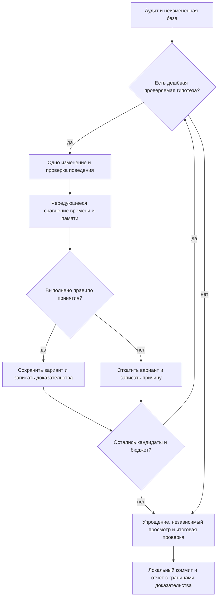

# Измеримые локальные улучшения производительности - Plan

## Goal Capsule

- **Цель:** уменьшить подтверждённые локальные задержки и лишние затраты Mac при работе с длинными текстами, сохранив привычное поведение приложения.
- **Способ:** широкий аудит исходников и последовательные небольшие эксперименты с измеримым результатом по KTD1–KTD3.
- **Полномочия:** локальные изменения и проверки разрешены. Работа выполняется в текущей `main`; новую ветку, PR и отправку в удалённый репозиторий не создавать.
- **Приоритет правил:** явный запрос владельца, `AGENTS.md`, продуктовые требования R1–R9, технические решения KTD1–KTD6, отдельные работы U1–U6.
- **Остановка:** общий бюджет измерительных запусков исчерпан, дешёвых доказуемых кандидатов больше нет либо кандидат требует изменения продуктового договора.
- **Завершает работу:** координатор принимает результаты, проводит итоговую проверку и создаёт локальный коммит только из разрешённых изменений.

---

## Product Contract

### Краткое содержание

Аудит охватывает редактор, историю, сетевой клиент, запуск, простой, сборку и размер приложения. Исправления ограничены небольшими локальными изменениями, полезность которых можно проверить без настоящих данных и запросов к провайдеру.

### Постановка проблемы

Предыдущий аудит обнаружил заметные локальные задержки на очень длинных текстах, но не доказал срочной проблемы на обычных коротких расшифровках. Стоимость отдельных операций известна; частота крупных текстов и полный путь до видимого кадра пока неизвестны. Поэтому устранение предполагаемой дорогой работы требует нового сравнения на исходном коде и на варианте изменения.

### Requirements

**Объём и доказательства**

- R1. Провести широкий аудит производительности и проверить только дешёвые кандидаты, сохраняя изменение лишь после измеримого выигрыша.
- R2. Соблюдать методику `docs/research/performance/README.md` и ограничения прошлого `docs/research/performance/journal.md`; каждую попытку, включая откат, записать в отдельный новый журнал текущей работы.
- R3. Ограничить измерительные запуски 30 минутами суммарно и использовать синтетические тексты с подставными зависимостями; платные вызовы и доступ к настоящим ключам, истории и каналу обновлений исключены.
- R4. Отделять подтверждённое поведением исходников, измеренное, допущения и `NOT_PROVEN`; непроверенный полный путь пользователя, простой, энергия и расходы описывать как `DEGRADED`.

**Сохранение поведения**

- R5. Сохранить полную раскладку и точный ползунок текстовых полей, переносы строк, редактирование, выделение, фокус и отмену правок согласно `DESIGN.md` и комментариям `AlignedTextView.swift`.
- R6. Сохранить последние пять полных пар истории, полное копирование и открытие записи, видимые три строки карточки, текущие счётчики графем и доступность.
- R7. Сохранить действующие договоры `AGENTS.md` о HTTPS, происхождении ключа, перенаправлениях, приватности и изолированном запросе, а также лимит ответа, бюджет времени и защищающие паузы. Отмена остаётся `APIError.cancelled` и не запускает повтор запроса.

**Завершение**

- R8. Не изменять и не включать в коммит существующие пользовательские изменения `AGENTS.md` и ранее созданные файлы `docs/research/performance/`; новые план, аудит и журнал учитывать отдельно.
- R9. Завершить необходимые проверки, независимый просмотр изменений и локальный коммит в текущей `main`; публикация и выпуск версии в объём не входят.

### Примеры приёмки

- AE1. Для задачи, отменённой до вызова очистки с корректными настройками, вызов заканчивается `APIError.cancelled`, подставной обработчик получает ноль запросов. Covers R7.
- AE2. После открытия длинной сохранённой записи ползунок сразу отражает весь документ, прокрутка достигает последних символов обоих полей. Covers R5, R6.
- AE3. Копирование карточки возвращает весь результат, открытие возвращает полную пару, счётчик не меняется на составных символах и эмодзи. Covers R6.

### Границы работы

Переходы на другую архитектуру, новый кеш результатов, изменение формата истории, ограничения длины текста и расходов требуют отдельного решения владельца. В текущем проходе они не реализуются.

Удаление полной раскладки, подсчёт кодовых единиц вместо графем и сокращение защищающих пауз рассмотрены и исключены по R5–R7. Повтор оптимизации обычного подсчёта символов исключён без новых доказательств: прошлый журнал уже отклонил её из-за малой стоимости.

Рекомпрессия значка не входит в активные работы: даже заметное уменьшение ресурса ещё не доказывает полезного уменьшения всего приложения. Повтор рассмотрения возможен при измеренном эффекте на размер пакета выше KTD2 без потери качества.

---

## Planning Contract

### Технические решения

- KTD1. **Один эксперимент за раз.** Чтение независимых областей возможно параллельно, но измерения и изменения выполняются последовательно одним назначенным исполнителем. Исходный снимок до первого исправления остаётся базой итогового сравнения. Это отделяет вклад изменений и соблюдает R1–R4.
- KTD2. **Единое правило принятия.** На одинаковом оптимизированном стенде, одинаковых входах и фиксированном количестве повторов получить минимум три прогретые исходные серии. Порог выигрыша медианы равен `max(10%, (max − min) / median)` этих серий. Затем провести пять чередующихся пар «до/после»; достаточно трёх только при исходном разбросе не более 5% либо доказанном исчезновении самой дорогой работы. Каждый результат после должен быть быстрее каждого результата до. Корректность обязательна, рост текущего RSS относительно сопоставимого исходного состояния не должен превышать 10% и должен выходить на плато после прогрева. Не прошедший хотя бы одно условие вариант откатывается точечно. Порог RSS — допущение для текущих локальных сценариев, а не обещание памяти всего приложения.
- KTD3. **Сначала устранение работы уже отменённой задачи.** Первым проверить кодирование полного запроса при входе в уже отменённую `Task` в `OpenAICompatibleClient.swift:55–85`. Затем проверить начальную раскладку при ещё не установленной ширине в `AlignedTextView.swift:55,235`. После этого, если остаётся бюджет, проверить работу карточек истории. Порядок отражает цену изменения и риск R5–R7; величина выигрыша заранее не установлена.
- KTD4. **Характеризация до изменения.** Стенды вызывают настоящий компонент, а не его упрощённый аналог. Проверку UI выполнять локально в оболочке с синтетическими текстами и подставными сервисами, без создания настоящих сетевого и обновляющего сервисов. Точная ширина, шрифты и путь TextKit фиксируются. Отдельная микрооперация не доказывает полное время до кадра по R4.
- KTD5. **Документация новой работы отдельно.** Координатор создаёт новый файл в `docs/research/performance/audits/`, содержащий отчёт и отдельный раздел журнала попыток; ссылки связывают его с этим планом и существующей методикой. Существующие файлы не переписываются по R8. Временные исходники стендов и сырые данные остаются в системном временном каталоге; абсолютные пути в репозиторий не попадают.
- KTD6. **Сокращать только окончательно проверенный вариант.** Упрощение кода и независимый просмотр выполняются после последовательных экспериментов. Любая поведенческая поправка после них требует повторного решающего сравнения с неизменённым начальным снимком. Координатор владеет окончательной приёмкой по R9.

### Допущения

Пороги KTD2 и общий бюджет R3 выбраны в предоставленных координатором условиях; владелец разрешил выбирать метрики без дополнительного согласования. Реальная частота больших текстов, уже отменённых вызовов и повторных пересчётов карточек — `NOT_PROVEN`.

Второй контроль отмены перед декодированием ответа, ограничение визуального фрагмента истории и кеширование счётчиков — условные кандидаты. Они не получают права на реализацию без отдельного доказательства дорогой работы и возможности сохранить R5–R7.

Внешние источники не определяют выбранный способ: работа следует фактическим локальным компонентам и текущим тестам. Результаты стендов, их полнота и поведение TextKit выясняются при исполнении; план не выдаёт гипотезу за измеренное улучшение.

### Последовательность и условия перехода

### Риски и исходные сведения

Обычное поле, которому заранее выставили конечную геометрию, не воспроизводит возможный второй проход при первом открытии заполненной истории. Стенд прошлого аудита исследовал именно готовую геометрию; новое начальное открытие должно быть отдельным сценарием.

Отмена редактора уже меняет его видимое состояние сразу (`EditorViewModel.swift:157–166`). Ускорение отменённого вызова клиента уменьшает лишнюю локальную работу, но само по себе не доказывает ускорение кнопки отмены.

Фиксированный префикс результата может изменить переносы, многоточие и обработку текста справа налево. Простой предел символов не считается доказательством сохранения трёх видимых строк.

Источники: `docs/research/performance/README.md`, `docs/research/performance/journal.md`, `docs/research/performance/audits/2026-10-13.md`, `DESIGN.md`, `Sources/Rusifikator/Components/AlignedTextView.swift`, `Sources/Rusifikator/History/HistoryView.swift`, `Sources/Rusifikator/Networking/OpenAICompatibleClient.swift`.

---

## Implementation Units

### U1. Аудит и сопоставимая исходная база

**Цель:** связать дешёвые кандидаты с конкретной работой приложения и сохранить исходную точку сравнения.

**Требования:** R1–R4, R8; KTD1, KTD2, KTD5. **Зависимости:** нет. **Владелец:** координатор и единственный исполнитель измерений.

**Файлы:** новый аудит с журналом в `docs/research/performance/audits/`; этот план. Исходники стендов вне репозитория.

**Подход:** изучить редактор, историю, клиент, запуск, простой, сборку и упаковку; для каждого указать подтверждённую работу, защищаемый договор и границу измерения. Сохранить исходный снимок и условия машины. Не повторять дорогие полные сборки и старые измерения ради полноты, если новых оснований нет.

**Проверяемые сценарии:**

1. Исходное состояние отслеживаемых и неотслеживаемых файлов отделено от новых артефактов.
2. Клиент вызывается на гарантированно отменённой задаче с синтетическим входом 1/100 тысяч и миллиона знаков; фиксируются время, текущий RSS, ошибка и число запросов.
3. Заполненное поле сначала создаётся без окончательной ширины, затем получает рабочую ширину; измеряется весь этот переход с 1/10/100 тысячами знаков и отдельным стрессовым миллионом.
4. Пять неизменных карточек истории измеряются при первичном показе и изменении подтверждения копирования.

**Проверка:** перед изменением каждого кандидата есть сопоставимые прогретые серии по KTD2. Если стенд не воспроизводит реальный путь или бюджет исчерпан, кандидат отклонён с обозначенной границей.

### U2. Не кодировать запрос задачи, уже отменённой при входе

**Цель:** устранить ненужную обработку длинного входа после состоявшейся отмены.

**Требования:** R1, R3, R4, R7; AE1; KTD2–KTD4. **Зависимости:** U1. **Владелец:** один исполнитель текущего эксперимента.

**Файлы:** `Sources/Rusifikator/Networking/OpenAICompatibleClient.swift`; `Tests/RusifikatorTests/APIClientTests.swift`; при необходимости `Tests/RusifikatorTests/EditorViewModelTests.swift`.

**Подход:** добавить самый ранний полезный контроль отмены перед дорогим кодированием, возвращая действующий тип ошибки. Предварительно зафиксировать приоритет имеющихся проверок пустого ключа и невалидного URL; сохранить его, расположив контроль после дешёвой валидации. Гарантия относится к отмене, уже видимой при входе: синхронное кодирование не становится прерываемым. Второй контроль перед декодированием исключён из этого изменения и требует отдельного сравнения.

**Образец:** обработчик отмены `StreamingRequest.load` и существующий `testCancellationIsCategorizedWithoutRetry`.

**Проверяемые сценарии:**

1. Covers AE1. Гарантированная отмена до входа с корректными настройками возвращает `APIError.cancelled`; отправки и повтора нет.
2. Обычный успешный запрос сохраняет две текущие роли сообщений и возвращает тот же нормализованный результат.
3. Отмена уже начавшегося запроса остаётся корректной и не вызывает повтор TLS.
4. Пустой ключ и небезопасный адрес сохраняют приоритет ошибок, установленный до изменения.
5. Сетевые договоры R7 проходят действующую проверку без ослабления утверждений.
6. Проверка подключения через тот же частный `clean` сохраняет отдельный короткий текст и свой бюджет времени; заранее отменённая корректная проверка не отправляет запрос.

**Проверка:** KTD2 выполнен для времени уже отменённого вызова; число запросов равно нулю. Успешный обычный путь не показывает устойчивой регрессии. Выигрыш сообщается только для измеренного сценария.

### U3. Проверить избыточную начальную раскладку заполненного поля

**Цель:** убрать только доказанный лишний проход перед окончательной шириной поля.

**Требования:** R1, R4–R6; AE2; KTD2–KTD4. **Зависимости:** U1, завершённый эксперимент U2. **Владелец:** один исполнитель текущего эксперимента.

**Файлы:** `Sources/Rusifikator/Components/AlignedTextView.swift`; новый `Tests/RusifikatorTests/AlignedTextViewTests.swift` при необходимости поведенческой проверки AppKit.

**Подход:** сначала доказать два прохода в реальном начальном цикле `NSHostingView` с настоящим `AlignedTextView`. При подтверждении проверить минимальный пропуск работы при нулевой ширине, сохранив полную синхронную раскладку при пригодном положительном размере по R5. Положительная ширина сама по себе не доказывает окончательную геометрию: проверяются последующие смены размера и готовность до первого кадра. Если воспроизведение требует искусственного порядка, который приложение не использует, эксперимент остановить.

**Образец:** существующий контроль ширины в `layout()` и комментарии `layOutWholeText()`; операции пользовательского изменения идут через `Coordinator.textDidChange`.

**Проверяемые сценарии:**

1. Covers AE2. Первое открытие заполненного поля и обоих полей истории сохраняет итоговый размер документа и прокрутку до конца.
2. Смена ненулевой ширины меняет переносы и сразу корректирует ползунок; повтор при той же ширине не меняет результат.
3. Программная замена сохраняет очистку старых операций отмены; пользовательская вставка сохраняет отмену и повтор.
4. Пустой текст, один длинный абзац и короткие абзацы сохраняют геометрию, выделение и фокус.
5. Кнопки поверх текста сохраняют зоны указателя и положение полосы прокрутки.

**Проверка:** пройден KTD2 на полном начальном переходе, завершающая полная раскладка подтверждена; затронутые потоки визуально просмотрены по KTD4. Удаление полного прохода без замены запрещено R5.

### U4. Проверить стоимость трёхстрочных карточек истории

**Цель:** уменьшить работу с длинным результатом только при сохранении карточки и полного содержимого записи.

**Требования:** R1, R4, R6; AE3; KTD2–KTD4. **Зависимости:** U1, завершённые эксперименты U2 и U3. **Владелец:** один исполнитель текущего эксперимента.

**Файлы:** `Sources/Rusifikator/History/HistoryView.swift`; новый `Tests/RusifikatorTests/HistoryPreviewTests.swift` только при реализации отдельно проверяемого поведения.

**Подход:** проверить фактическую стоимость `Text(entry.result)` при лимите трёх строк. Ограниченное визуальное представление допустимо лишь при доказанном совпадении текущих строк и многоточия. Если дешёвое локальное решение не сохраняет это, вариант отклонить. Полный текст остаётся источником для копирования, подробной записи и нынешнего описания доступности.

**Проверяемые сценарии:**

1. Covers AE3. Копирование и открытие возвращают полное содержимое даже для длинной записи.
2. Короткий текст, пустые строки, длинное слово и граница третьей строки сохраняют те же видимые строки и многоточие.
3. Составные символы, эмодзи, символы с нулевой шириной и текст справа налево сохраняют текущее отображение и счётчики.
4. Смена подтверждения копирования, повторный показ и новая запись сохраняют правильные карточки и описание доступности.

**Проверка:** пройден KTD2 и визуальное сравнение по KTD4 на пяти карточках. Повторное вычисление `entry.source.count` не оптимизируется в этом же варианте: это отдельная гипотеза без нового доказательства.

### U5. Упростить и независимо проверить сохранившиеся изменения

**Цель:** оставить минимальные изменения с установленной пользой и без скрытого изменения договоров.

**Требования:** R5–R9; KTD6. **Зависимости:** все начатые эксперименты U2–U4 завершены. **Владелец:** координатор; независимый исполнитель просмотра читает окончательные изменения.

**Файлы:** только фактически изменённые исходники и тесты из U2–U4.

**Подход:** убрать усложнения и остатки отвергнутых вариантов, затем проверить поведение и границы R5–R7 свежим контекстом. Все существенные замечания решить до окончательной приёмки. Не добавлять смежную уборку.

**Проверяемые сценарии:** повторить решающие сценарии тех работ, которые изменены после первоначального принятия.

**Проверка:** замечания имеют решение и первичное подтверждение. Итоговый вариант снова проходит KTD2 относительно исходного снимка.

### U6. Итоговая проверка, доказательства и локальный коммит

**Цель:** сделать результат воспроизводимым и отчётным без включения чужих изменений.

**Требования:** R2, R4, R8, R9; KTD5, KTD6. **Зависимости:** U5. **Владелец:** координатор.

**Файлы:** новый аудит с журналом, этот план; только принятые исходники и тесты.

**Подход:** зафиксировать до/после, размер выборки, абсолютное время, память и предел доказательства каждой попытки. Выполнить договор проверок ниже, проверить состав индекса и создать локальный коммит. При отсутствии принятых оптимизаций сохранить честный аудит с причинами отклонения.

**Ожидание тестов:** новых автоматических тестов для коммита и описания чисел нет; требуются существующие проверки и сверка сырых доказательств.

**Проверка:** коммит включает только разрешённые файлы по R8; временные воспроизводимые сборки удалены, исходники стендов и данные сохранены для проверки.

---

## Verification Contract

- Для каждого принятого изменения выполнить `swift build` и `swift test`; focused-проверки дополняют их и не заменяют итоговый успешный запуск.
- UI-поведение U3/U4 проверить визуально на локальной оболочке по KTD4. Если оболочка не воспроизводит затронутый поток, изменение UI не принимается.
- Обязательное решающее сравнение выполняется после U5 на начальном снимке и окончательном варианте; критерий принятия принадлежит KTD2.
- Только если фактически затронуты упаковка, ресурсы или метаданные: `scripts/package-app.sh` и `scripts/smoke-test-app.sh dist/Rusifikator.app`. Их изменение не входит в предполагаемые U2–U4.
- Если затронута системная инструкция, выполнить `scripts/test-system-prompt.sh` и сохранить идентичность обеих копий; её изменение не входит в текущий план.

---

## Definition of Done

Аудит завершён, все начатые кандидаты приняты по KTD2 либо точечно отменены с причиной в новом журнале. Окончательный вариант проверен после упрощения и независимого просмотра. Неизмеренные области явно обозначены по R4.

Координатор создал локальный коммит по R8/R9, сохранил исходники стендов и сырые данные и удалил только созданные этой работой воспроизводимые временные сборки. В изменениях нет экспериментального кода отвергнутых вариантов, настоящих данных пользователя, секретов и абсолютных путей. Если использованы `$CODEX_HOME/evidence` или `$CODEX_HOME/worktrees`, итоговый отчёт содержит размер и судьбу созданных данных.
