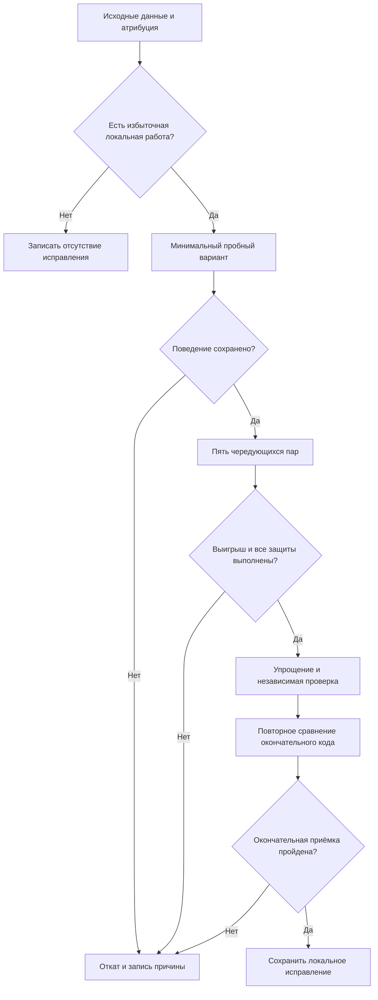

# Локальные действия и повторные обновления истории - Plan

## Goal Capsule

- **Цель:** при работе с большими текстами пользователь получает прежние полные результаты и историю с меньшими подтверждёнными локальными затратами; для остальных направлений известна проверенная причина отсутствия исправления либо граница доступных доказательств.
- **Способ:** исследование фактического дерева приложения и условные локальные исправления подтверждённой избыточной работы (KTD1–KTD4).
- **Приоритет:** требования пользователя → `AGENTS.md` и `DESIGN.md` → R1–R10 → технические решения и единицы этого плана.
- **Исполнение:** текущая `main`, исходный коммит `c9d3c2acf72983ffef2c2585a30e5335099b5cd3`; локальный коммит выполняет основная сессия после окончательной приёмки. Публикация не входит в работу.
- **Остановка гипотезы:** недостаточная причина, нарушение R2–R9 или исчерпанный резерв означает отклонение опыта и запись результата. Не требуется отдельное исправление для каждого направления.

---

## Product Contract

### Краткое содержание

Проверить шесть оставшихся направлений: запуск и открытие экранов, большие вставки, карточки истории, память повторных действий и отмены, простой, локальную часть ответа провайдера. Сначала уменьшать подтверждённую повторную работу карточек при изменении отметки копирования; другие исправления допустимы только после атрибуции причины.

### Постановка проблемы

Прежняя серия устранила раскладку поля при нулевой ширине, но не проверила весь путь приложения, пользовательскую отмену и простой. Фиксированный префикс истории нарушил изображение; контроль отмены перед кодированием не прошёл защиту памяти и откатан. Эти попытки нельзя возобновлять без новых доказательств.

Новая исходная серия на настоящем `PopoverRootView` установила повторное построение пяти неизменных карточек при отметке копирования. При 100 тысячах графем построение метаданных занимает 3,0032/2,8437/2,8616 мс; при миллионе — 28,2745/28,9504/29,4572 мс. Это стоимость локальной работы, а не задержка увиденного кадра. Показ кадра и стандартная команда отмены в изолированной среде пока недоступны.

### Requirements

**Поведение**

- R1. Каждое из шести направлений завершается проверяемым результатом: принятым исправлением, мотивированным отказом от него или явно указанной недоступной проверкой.
- R2. Сохранить нынешние пределы текста, пять полных пар истории и всю доступную пользовательскую отмену; не ограничивать их ради измерений.
- R3. Сохранить геометрию `DESIGN.md`, полную высоту документа и точный ползунок после обязательной раскладки, переносы, выделение, фокус, составной ввод и программную очистку отмены при отличающейся строке.
- R4. Карточка сохраняет три строки полного результата, дату, число графем, описание доступности и полные действия открытия/копирования. В списке подтверждается только последняя скопированная карточка; копирование другой немедленно снимает прежнюю отметку, исчезновение экрана отменяет задачу подтверждения.
- R5. Сохранить условия `AGENTS.md` и защитные интервалы методики: изоляцию запросов, HTTPS и источник ключа, безопасные перенаправления, отсутствие содержимого/секретов в диагностике, ограничение ответа и времени, единственный TLS-повтор, очистку при открытии и длительность подтверждения копирования.

**Доказательства**

- R6. Исправление принимается после проверки корректности и пяти чередующихся пар на одинаковых входах и прогреве: выигрыш медианы строго больше `max(10%, (max − min) / median)` исходной серии, каждое значение после меньше каждого значения до. Сохранять все пары и провалы; не менять прогрев или порог задним числом.
- R7. Текущая резидентная память в каждой сопоставимой прогретой паре не превышает исходную более чем на 10%; ограниченный цикл одинаковых состояний выходит на плато в точках 10/50/100. Накопление полной отмены измеряется отдельно с её глубиной и живыми объектами, без скрытого сброса; оно не доказывает утечку само по себе.
- R8. Результат охватывает только наблюдаемый конечный сигнал. Создание объектов, обработка очереди, растровый снимок и вызов рисования не доказывают показанный кадр; локальные байты ответа не доказывают первый ответ модели, TLS, энергию или расходы.

**Границы исполнения**

- R9. Все запуски используют синтетические данные и подставные ключи, провайдера, буфер обмена, вход в систему и Sparkle; отдельные настройки, история, идентификатор и блокировка, плюс внешний запрет сети. Настоящие пользовательские данные, платные вызовы и изменение общих систем исключены.
- R10. Сохранить пользовательские изменения `AGENTS.md` и старые незакоммиченные `docs/research/performance/README.md`, `journal.md`, `audits/2026-10-13.md` без правок и вне коммита. Новый аудит и журнал этой серии находятся в `docs/research/performance/audits/2026-10-14-local-flow.md`.

### Ключевые решения

- **Нынешние ограничения сохраняются.** (session-settled: user-directed — chosen over new input/history limits: владелец сохраняет полный текст и нынешнюю историю.) Governs R2.
- **Полный локальный путь и простой исследуются в изоляции.** (session-settled: user-directed — chosen over real provider and shared-system profiling: владелец выбрал локальную безопасную область.) Governs R8, R9.

### Примеры приёмки

- AE1. Covers R4. После копирования карточки A, затем B, полный текст B передан подставному буферу, отметка A снята сразу; поздняя задача A не снимает отметку B.
- AE2. Covers R3, R4. Результат с 2048 невидимыми графемами перед видимым текстом, эмодзи и смешанным направлением отображается как исходная версия, открывается и копируется полностью.
- AE3. Covers R6–R8. Снижение процессорной работы истории можно сохранить при выполнении всех защит; недоступный показ кадра остаётся `NOT_PROVEN` и не превращается в обещание ускорения всего интерфейса.

### Границы работы

Сеть, настоящая цена Keychain, Sparkle, тариф и счёт остаются `NOT_PROVEN` по R8–R9. Изменение потокового отображения, повторное использование сессий, политика свежести ключа и жизненный цикл скрытых представлений требуют отдельного будущего решения владельца и не блокируют эту серию.

Не строить постоянную телеметрию, новые ограничения памяти/отмены или кеш результатов. Не повторять прежние кеши обычного подсчёта/обрезания, фиксированный визуальный префикс, откат контроля отмены или удаление символов упаковки без новых причин. Доказательством для пересмотра станет измеренный вклад в фактическое действие и соблюдение прежних защит.

---

## Planning Contract

### Технические решения

- KTD1. **Атрибуция предшествует правке.** Использовать существующие исходные серии и отдельную временную копию настоящего дерева. Не менять TextKit, API и структуру хранения по одному признаку создания объекта; R1, R3, R5.
- KTD2. **Изолировать неизменное содержимое карточки от родительской отметки.** Проверить небольшую границу представления внутри `HistoryView.swift`, сохранив исходный полный `Text` и родительское управление последней отметкой/задачей по R4. Конкретная граница выбирается исполнителем; общий кеш и перенос подсчётов в запись истории заранее не требуются.
- KTD3. **Принятие истории доказывает процессорную работу.** Основной сигнал — процессорное время фактического изменения отметки на настоящем дереве; время построения метаданных и количество вызовов объясняют причину. Обязательный соседний сигнал — весь локальный проход с обработкой очереди и рисованием, включая неизменную паузу 20 мс. Не вычитать её и не называть проход показанным кадром; R6, R8.
- KTD4. **Защиты фиксируются до первой пары.** Записать входы, прогрев, порядок, основную метрику и соседние пути в декларацию опыта. При любой неудачной защите вернуть только изменение опыта и записать причину; R6–R7.
- KTD5. **Бюджет конечен.** Суммарный учёт измерительных команд — 1800 с, исходная серия не более 500 с; не менее 900 с зарезервированы под исправления и финальные проверки. Работу измеряет один исполнитель; при нехватке бюджета дополнительные гипотезы закрываются без исправления, а обязательная проверка не заменяется догадкой.

### Условия наблюдения и допущения

Физическое представление окна недоступно: собственное окно рисуется, но `occlusion_visible=false`; Computer Use не обнаруживает приложение, разрешений записи экрана и доступности нет. Стандартная команда отмены с целью `nil` не доставляется. Это ограничение среды, не доказательство ошибки приложения; дополнительную настройку системы ради него не продолжать. R3 остаётся обязательным: редакторский кандидат, требующий неподтверждённой новой семантики отмены/составного ввода, не принимается.

Подставной буфер доказывает полный переданный текст и порядок вызова, но не задержку системного буфера. Частота текстов 1/10/100 тысяч и миллиона неизвестна; миллион всегда отдельно обозначается как стресс. Гипотеза о полезной границе карточки ещё не является принятым исправлением.

### Матрица обязательных соседних путей

| Область | Основной допустимый сигнал | Соседние проверки |
|---|---|---|
| Запуск/открытие | Локальные этапы и рисунок; полный кадр недоступен | Первое и повторное открытие, активация, отсутствие переноса затрат |
| Большая вставка | Настоящая правка, синхронизация и обязательная раскладка | Программная замена, ширина, выделение, отмена, загрузка |
| Отметка карточки | Процессорное время изменения отметки по KTD3 | Первый список, другая отметка, исчезновение, открытие/возврат, запись/загрузка истории |
| Память | Текущий RSS и живые объекты в одинаковых состояниях | 10/50/100 циклов, полная отмена, очистка и уничтожение |
| Простой | Абсолютное процессорное время в фиксированном интервале | Скрытое/видимое/заполненное окно, каретка, состояние после действий |
| Клиент | Кодирование, подставной ответ, публикация полного результата | Отмена/ошибка, число вызовов, размер и изоляция запроса |

Соседние метрики не должны ухудшаться за пределами заранее записанного исходного разброса; такой провал отклоняет кандидат. Недоступные проверки нельзя объявлять успешными.

### Условия перехода

U1 снабжает U2–U7 данными. Первый опыт — U4: причина уже измерена. U2, U3, U5–U7 могут завершиться без изменений кода. U8 следует за всеми направлениями; последовательные измерения не мешают отдельному чтению и проверке документов.

### Исходные сведения и риск

`AlignedTextView.Coordinator` переносит пользовательскую строку в модель и запрашивает полную раскладку; `EditorViewModel.sourceDidChange` снимает устаревшее состояние; `updateNSView` сравнивает строки и очищает отмену только при программной замене. `HistoryView.historyRow` сейчас строит метаданные на родительском состоянии. `PopoverRootView` переключает страницы, `AppDelegate` удерживает модели; прежний порядок запуска и синхронное чтение настроек установлены по коду, их настоящая цена не доказана.

Методика и прежние отвергнутые варианты: `docs/research/performance/README.md`, `journal.md`, `audits/2026-10-14-fixes.md`. Новые исходники стендов, числовые результаты, ошибки подготовки, декларации и SHA-256 хранятся в системном временном каталоге задачи; новый аудит по R10 даёт воспроизводимые ссылки на имена файлов без локальных абсолютных путей. Измерение в этой среде остаётся `DEGRADED` для показанного кадра, стандартной команды отмены и внешних ресурсов.

---

## Implementation Units

### U1. Закрепить исходную серию и изоляцию

**Цель:** данные фактического приложения имеют проверяемое происхождение и безопасную границу.
**Требования:** R1, R8–R10. **Зависимости:** нет.
**Файлы:** временные исходники стенда и журналы; `docs/research/performance/audits/2026-10-14-local-flow.md`.
**Подход:** переиспользовать исходный снимок `c9d3c2a`, действующий стенд и первичные результаты. Проверить явно подставленные зависимости: отдельного идентификатора недостаточно для фиксированных путей истории/Keychain. Дополнить итог исходной серии в пределах KTD5, сохранив ошибки её подготовки.
**Сценарии:**

1. Запуск касается только временных настроек, истории и блокировки; подставные службы не вызывают настоящий Keychain, регистрацию входа, Sparkle или буфер.
2. Прямая команда копирования в истории также использует подставной буфер; внешний запрет сети действует независимо от подстановки API.
3. Недоступные кадр/обычная команда отмены обозначены по R8, без повторного изменения системных разрешений.

**Проверка:** исходные хеши, декларация изоляции, сырые результаты и учёт бюджета сохранены; исходные серии содержат не менее трёх повторов на выбранный сигнал.

### U2. Закрыть запуск, открытие редактора и истории

**Цель:** известны локальные этапы запуска и переходов, а перенос ожидания не принят за выигрыш.
**Требования:** R1, R3, R8–R9. **Зависимости:** U1.
**Файлы:** временный стенд, новый аудит; исследуются `Sources/Rusifikator/App/AppDelegate.swift`, `Sources/Rusifikator/App/PopoverCoordinator.swift`, `Sources/Rusifikator/Settings/SettingsView.swift`.
**Подход:** читать уже измеренные этапы создания моделей, дерева и значка, первый/повторный переходы. При текущей границе R8 не переставлять запуск или откладывать дерево ради недоказанного показанного кадра; настоящее чтение Keychain не исследуется.
**Ожидание тестов:** новых автоматических тестов нет — единица закрывает исследование, не меняет поведение.
**Проверка:** отдельные локальные длительности и недоступные конечные сигналы отражены в аудите; архитектурного изменения нет.

### U3. Атрибутировать большую вставку и синхронизацию

**Цель:** разделить обязательную раскладку и повторную работу приложения без потери текста.
**Требования:** R1–R3, R6–R9. **Зависимости:** U1.
**Файлы:** `Sources/Rusifikator/Components/AlignedTextView.swift`, `Sources/Rusifikator/Editor/EditorViewModel.swift`, `Tests/RusifikatorTests/EditorViewModelTests.swift`; временный настоящий компонент и новый аудит.
**Подход:** использовать реальные правки начала/конца, вызовы координатора/обновления и время раскладки. Пробный локальный вариант допустим только при новой материальной избыточной работе по KTD1 и независимом подтверждении затронутых условий R3; иначе завершить без правки. Ревизии строки или кеш заранее не выбираются.
**Сценарии при кандидате:**

1. Внешняя одинаковая строка сохраняет выделение и отмену; отличающаяся применена полностью с прежней очисткой отмены.
2. Пустота, пробелы, составные графемы и смешанное направление сохраняют состояние модели и текста.
3. Вставка начала/конца и ширины 280→520→400 сохраняют полную высоту, ползунок, фокус и области кнопок.
4. Составной ввод и восстановление пользовательских правок не теряются; неподтверждённое условие отклоняет кандидат.
5. Загрузка блокирует правки, поздний ответ не восстанавливает очищенный текст, правка после успеха снимает результат.

**Проверка:** R6–R7 плюс матрица соседних путей; вывод относится к компонентному сигналу по R8.

### U4. Уменьшить повторную работу неизменных карточек

**Цель:** отметка копирования требует меньше процессорной работы при прежнем содержимом истории.
**Требования:** R2, R4, R6–R9; AE1–AE3. **Зависимости:** U1.
**Файлы:** `Sources/Rusifikator/History/HistoryView.swift`; при нужной устойчивой проверке — новый `Tests/RusifikatorTests/HistoryViewTests.swift`; временный настоящий `PopoverRootView` и новый аудит.
**Подход:** испытать KTD2, сохранив неизменные исходные данные карточки и родительскую последовательность отметок. Стенд вызывает тот же путь с подставным буфером и отдельно наблюдает построение карточки/расход процессора/полный локальный проход по KTD3. Не переносить цену в `HistoryStore.record`.
**Указание исполнения:** сначала сравнить поведение и изображение, затем измерять; не добавлять тест, повторяющий структуру представления.
**Сценарии:**

1. Covers AE1. A→B до истечения подтверждения снимает A сразу; истечение отменённой задачи не меняет B.
2. Исчезновение списка отменяет задачу; возврат и последовательные копирования сохраняют прежнее состояние.
3. Covers AE2. Пять карточек совпадают по изображениям и доступным подписям на невидимом префиксе, графемах, эмодзи, RTL и тексте за пределом трёх строк.
4. Полное копирование и открытие детали сохраняют исходный payload; черновик не меняется; исчезнувший идентификатор ведёт к списку.
5. Загрузка, пустая история, ошибка и повтор сохранения остаются прежними; число записей, порядок и даты не меняются.

**Проверка:** фактическое снижение процессорной работы по R6, память по R7 и соседние пути без регрессии. Отсутствие повторных вызовов само по себе не доказывает время; полный кадр остаётся вне утверждения.

### U5. Проверить память и жизненный цикл отмены

**Цель:** различить полезное удержание и необоснованный рост, сохраняя полную отмену.
**Требования:** R1–R3, R7–R9. **Зависимости:** U1; проверка кандидата U4 после его опыта.
**Файлы:** временный стенд и новый аудит; исследуются `Sources/Rusifikator/Components/AlignedTextView.swift`, `Sources/Rusifikator/App/PopoverCoordinator.swift`, `Sources/Rusifikator/History/HistoryStore.swift`, `Sources/Rusifikator/Editor/EditorViewModel.swift`; при фактическом изменении модели — соответствующие `Tests/RusifikatorTests/EditorViewModelTests.swift` и `Tests/RusifikatorTests/HistoryStoreTests.swift`.
**Подход:** разделить ограниченные циклы редактор→история→деталь→возврат с одинаковыми данными, накопление пользовательской отмены и предусмотренную очистку/уничтожение. Следить за текущей памятью и живыми объектами; пик памяти не является утечкой. Правка допустима только для доказанного нежелательного удержания; политика уничтожения страниц и глубины отмены не меняется.
**Сценарии:**

1. Ограниченные циклы 10/50/100 сохраняют объём живых данных и выходят на плато по R7.
2. Пользовательские правки сохраняют операции отмены и повтора; изменение их глубины не является способом пройти память.
3. Скрытие сохраняет черновик; возвращение после 120 секунд очищает его по прежнему условию, работающий запрос переживает очистку и попадает в историю.
4. Запись/очистка/повтор и ожидание финального снимка не теряют пять полных пар; после уничтожения измерительного корня его объекты освобождаются штатно.

**Проверка:** записаны сопоставимые состояния и числовые контрольные точки; отсутствие ошибки или невозможность команды не выданы за успешную отмену.

### U6. Проверить локальный простой

**Цель:** известны процессор и текущая память подставного приложения после стабилизации.
**Требования:** R1, R5, R7–R9. **Зависимости:** U1.
**Файлы:** временный стенд и новый аудит; исследуются `Sources/Rusifikator/Editor/EditorViewModel.swift`, `Sources/Rusifikator/App/AppDelegate.swift` и `Sources/Rusifikator/Updates/SparkleUpdaterService.swift` без изменения настоящего обновляющего сервиса.
**Подход:** сравнить одинаковые фиксированные интервалы скрытого, видимого пустого/заполненного окна, отдельно фокус и каретку. Подставной updater ограничивает вывод локальным интерфейсом. При шумовом или нулевом процессорном фоне не считать относительный выигрыш и не создавать искусственную проблему.
**Ожидание тестов:** новых автоматических тестов нет при исследовании без изменения поведения.
**Проверка:** абсолютное процессорное время, текущая память, длительность/состояние и исходный разброс сохранены; энергия батареи остаётся `NOT_PROVEN`. Обоснованный локальный кандидат потребует отдельной декларации по KTD4, не изменения защитных пауз.

### U7. Закрыть локальную сетевую границу

**Цель:** отделить работу клиента от неизвестного времени/расходов провайдера.
**Требования:** R1, R5, R8–R9. **Зависимости:** U1.
**Файлы:** временный стенд и новый аудит; исследуются `Sources/Rusifikator/Networking/OpenAICompatibleClient.swift`, `Sources/Rusifikator/Networking/APIModels.swift`, `Sources/Rusifikator/Networking/NetworkDiagnosticEvent.swift` и существующие `Tests/RusifikatorTests/APIClientTests.swift` без производственной правки.
**Подход:** переиспользовать исходную атрибуцию кодирования, подставного полного ответа, публикации/раскладки и отмены. Зафиксировать, что `stream: false` не создаёт пользовательский первый токен, а новая `URLSession` не доказывает новый TLS. Старый откат перед кодированием не повторяется.
**Ожидание тестов:** новых автоматических тестов нет — архитектура и контракт клиента не меняются.
**Проверка:** реальные первый/полный ответ, повторное соединение, usage, цена и счёт перечислены как недоступные данные для будущего решения владельца, без вызовов и без блокировки U4.

### U8. Проверить окончательный состав и сохранить результат

**Цель:** в коммит попадают только принятые исправления и проверяемые новые доказательства.
**Требования:** R1–R10. **Зависимости:** U2–U7.
**Файлы:** принятые исходники/необходимые тесты, этот план и новый аудит по R10.
**Подход:** пройти упрощение и независимую проверку окончательного изменения, разрешить замечания, затем повторить решающие пары на окончательных хешах. Если код изменился после проверок, повторить затронутые проверки. Удалить только созданные воспроизводимые временные сборки, сохранив исходники, сырые данные и доказательства; старые пользовательские материалы исключить.
**Сценарии:**

1. Окончательная версия проходит те же входы, состояния, пары и защитные пути, которые допустили кандидат.
2. Отклонённые варианты и их тесты отсутствуют в итоговом diff; производственные проверки не ослаблены.
3. Пользовательские файлы по R10 сохранились и не включены в коммит; исходники, журналы и обзор относятся к одинаковым хешам.

**Проверка:** весь Verification Contract выполнен, новый аудит содержит результаты/откаты, консервативный бюджет, ограничения и размеры оставленных доказательств.

---

## Verification Contract

- После изменения кода проходят `swift build` и `swift test`; существующие проверки состояния редактора, независимых запросов, отмены, безопасной диагностики и сохранения истории не ослабляются.
- Изменения ресурсов/метаданных/упаковки не планируются. Если они понадобились в согласованной области, обязательны `scripts/package-app.sh` и `scripts/smoke-test-app.sh dist/Rusifikator.app`; изменение инструкции также требует `scripts/test-system-prompt.sh` и побайтного совпадения фикстуры.
- Интерфейсная приёмка U4 включает фактическое дерево, сравнение изображений и состояния/доступности, подставные полные действия открытия/копирования. Проверка изображений не заменяет кадр; ограничение R8 остаётся в отчёте.
- Основная метрика U4 выполняет R6 на процессорном времени; метаданные и вызовы служат причинным подтверждением. Соседний полный локальный проход по KTD3 и матрица не ухудшаются сверх исходного разброса; память выполняет R7. Непрошедший кандидат откатывается даже при красивом количестве вызовов.
- Прогрев, 10/50/100 одинаковых циклов и матрица фиксируются до сравнения. Реальную отмену, Keychain, Sparkle, энергию и провайдера не проверяют подставными выводами.
- После упрощения/независимого просмотра окончательные хеши снова измерены пятью чередующимися парами. Проверка пробелов и состава изменения проходит; в аудит записаны все попытки и ограничения.

---

## Definition of Done

Каждое направление имеет результат по R1, а каждое сохранённое изменение выполняет R2–R9 и окончательную проверку U8. Общая оценка полного пути остаётся `DEGRADED`, пока конечный кадр и внешние ресурсы не доказаны; это не препятствует честно ограниченному локальному исправлению.

Не осталось кода отвергнутых опытов, несанкционированных архитектурных изменений и пользовательских файлов в составе коммита. Новый аудит по R10 содержит воспроизводимые имена доказательств, исходный/окончательный хеш, результаты пар, защит памяти, причины отказов, бюджет и судьбу временных данных. Основная сессия сохраняет принятый состав локальным коммитом текущей ветки.
