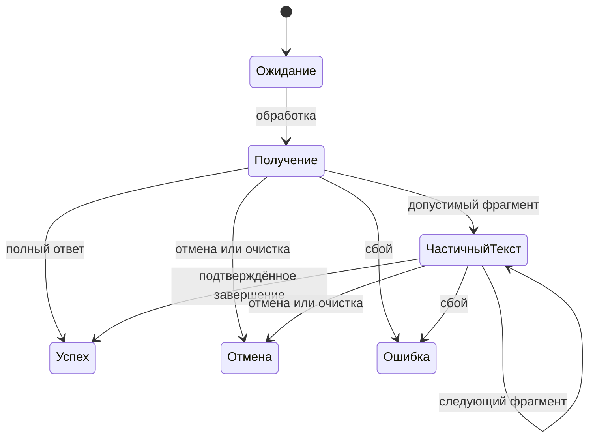

# Архитектурные варианты обработки и запуска
Created: 2026-10-14

**execution:** `knowledge-work`. Результат текущей работы — это досье решений и план получения недостающих доказательств. Документ не разрешает внедрять потоковый вывод, общую сессию или отложенный запуск.

## Цель и границы

Владелец должен получить сопоставимые варианты, их цену, риски и условия выбора. Сейчас неизвестны реальное время первого фрагмента/полного ответа, повторное использование соединений, задержка настоящего Keychain и частота больших текстов. Поэтому архитектурная польза не заявляется по подставным длительностям.

R1. Текущая работа ограничена чтением источников, описанием вариантов и проверкой полноты досье; производственные исходники, настройки, ключи, история и внешнее состояние не изменяются.

R2. Будущая реализация должна сохранить договоры `AGENTS.md`, `DESIGN.md`, `docs/research/performance/README.md`: изолированный запрос, HTTPS и привязку ключа к источнику, безопасные перенаправления, отсутствие cookies/кеша, секретов и текстов в диагностике, лимит ответа и общий срок, одну ограниченную попытку TLS, пять полных пар истории и прежние защитные ожидания.

R3. Реальные вызовы провайдера, профилирование установленного приложения и изменение разрешений требуют отдельного разрешения с целью, количеством запусков и бюджетом; текущее досье не заменяет его.

R4. Каждый вариант связывается с наблюдаемым эффектом для человека, требуемыми доказательствами, владельцами состояния и перечнем сценариев сохранения поведения.

## Что установлено в исходниках

- `Sources/Rusifikator/Networking/OpenAICompatibleClient.swift` отправляет `stream: false`. Несмотря на название `StreamingRequest`, сетевой обработчик накапливает ограниченный полный ответ, завершает задачу и отдаёт данные для разбора; это не потоковый показ текста.
- Обработчик владеет сессией и задачей одной попытки запроса. Завершение снимает ссылки и инвалидирует сессию; отмена использует отмену задачи и сессии. Новый экземпляр `URLSession` не доказывает новое соединение TCP/TLS.
- `Sources/Rusifikator/Editor/EditorViewModel.swift` принимает неизменный снимок, защищает результат идентификатором запроса и записывает историю только при полном успехе. Копирование доступно только при успехе; отмена/очистка исключают поздний результат.
- `Sources/Rusifikator/App/AppDelegate.swift` создаёт модели до создания значка, затем скрытое дерево всплывающего окна, значок и обновляющий сервис. Дерево сохраняется, но создаётся только ветвь текущей страницы; все экраны не создаются постоянно. `SettingsViewModel` находится в `Sources/Rusifikator/Settings/SettingsView.swift`; её зависимости включают ключи и автозапуск.
- `Sources/Rusifikator/Components/AlignedTextView.swift` использует полную раскладку ради точного ползунка и очищает отмену только при внешней программной замене. Потоковая замена текста может многократно запускать эту работу.

Источники текущих чисел и ограничений — `docs/research/performance/audits/2026-10-14-fixes.md` и `docs/research/performance/audits/2026-10-14-local-flow.md`. Последний подтверждает рост подставной оболочки, но не его владельца; новая архитектура не назначается исправлением этого роста.

## Решения о способе исследования

- KTD1. Сравнить три направления независимо; их совместный эффект нельзя сложить из отдельных подставных длительностей. Governs R4.
- KTD2. Сначала закрепить текущие переходы и владельцев, затем выбирать механизм. Будущие прототипы допускаются только отдельным решением; текущая работа их не запускает. Governs R1, R2.
- KTD3. В каждой рекомендации отделять первичные данные, следствие исходников и непроверенную гипотезу. Governs R3, R4.

## Варианты и условия выбора

| Направление | Сохранить нынешний способ | Возможный вариант | Что определяет выбор |
|---|---|---|---|
| Ответ | Показать только окончательный результат | Получать и показывать накопленный частичный текст | Время первого полезного фрагмента, стабильность формата провайдера, цена повторной раскладки |
| Сессия | Сессия принадлежит одному запросу | Ограниченный владелец сессии по источнику и поколению ключа | Настоящие метрики повторного соединения и отсутствие влияния отмены одной задачи на другую |
| Запуск | Создать модели и скрытое дерево до значка | Разделить готовность значка, моделей и дерева | Время показанного значка и первого полезного открытия с настоящими зависимостями |

Сохранение текущего способа — полноценная альтернатива во всех трёх направлениях. Выбор будущего механизма отложен; это не инструкция исполнителю начать реализацию.

### Частичный ответ

Потенциальная польза — человек раньше видит пригодную часть текста. Существующий полный путь проще: нормализация внешних кавычек/пробелов и пустого ответа выполняется один раз, до публикации. При потоковом пути требуется отдельный временный текст и завершение с окончательным результатом; частичный текст нельзя незаметно превратить в успешную запись истории.

Потоковый вывод независим от повторного использования сессии: одно направление не является предпосылкой другого. Предлагаемая граница для будущего решения: сетевой слой разбирает события, редактор владеет поколением запроса и временным результатом, интерфейс показывает его при неизменной геометрии. Частоту публикаций потребуется определить по измерению; произвольная задержка ради красивого теста не выбирается сейчас.

В досье будущего решения требуется разобрать:

1. Частичные байты UTF-8, границу события между пакетами, пустые/служебные события, порядок фрагментов, завершающий маркер и конец без завершения. Декодер ограничивает неполное событие, очередь публикаций и суммарные байты; накладные данные входят в прежний предел 4 МиБ.
2. Успех, HTTP-ошибку до данных, сбой после фрагмента, лимит ответа и общий срок; отображение остатка после ошибки является продуктовым решением владельца. Автоматический повтор полным режимом после неоднозначной отправки может повторно оплатить генерацию и не выбирается.
3. Отмену/очистку, отменённую отложенную публикацию и поздний фрагмент/финал первого запроса после второго; история содержит только подтверждённый полный успех.
4. Возможность копирования частичного текста, его подпись и отсутствие ложного успеха — отдельный выбор владельца. Действующее копирование полного результата остаётся исходным образцом.
5. Полную раскладку, прокрутку, выбор текста, фокус, настоящую отмену и составной ввод; промежуточное обновление не должно портить исходный редактор.
6. Нормализацию окончательного ответа, графемы/эмодзи/направления письма, приватность диагностики и освобождение временного результата.

Локальные подставные сценарии будущего прототипа опираются на `Tests/RusifikatorTests/APIClientTests.swift` и `Tests/RusifikatorTests/EditorViewModelTests.swift`. Их успех не докажет поддержку выбранным реальным провайдером или экономию оплаты.

### Повторное использование сессии и соединения

Потенциальная польза — меньше работы установления соединения. Подтвердить её могут только метрики реальных задач и время операции; существующий `serverWait` не выделяет вычисление модели из сети. Общая сессия потребует отделить владение задачей/продолжением от владельца сессии, который сегодня находится внутри одного обработчика.

Для будущего варианта с общим владельцем должны быть определены:

1. Область по нормализованному источнику и поколению ключа; ключ не входит в журнал или идентификатор диагностики.
2. Смена ключа/провайдера/модели, сохранение настроек, удаление ключа и ошибка загрузки: кто запрещает новым задачам старое поколение и кто завершает прежнее.
3. Отмена одной задачи, проверка подключения параллельно обработке, завершение приложения и освобождение последнего владельца; сессия не инвалидируется из-за отмены соседа.
4. Перенаправления, включая смену порта/схемы, отсутствие cookies/кеша, единственное завершение продолжения, лимит тела и ограниченный TLS-повтор по R2. Различные общие сроки проверки/обработки 30/90 с сохраняются отдельной политикой; тайм-аут бездействия не заменяет абсолютный срок.
5. Ограниченное число сохраняемых сессий, удаление завершённых задач из реестра и завершение делегата после инвалидирования. Смена владельца не обрывает активную соседнюю задачу.
6. Граница уже начатого снимка ключа и новых запросов после ротации. Это политика владельца, а не неявное следствие кеширования ключа.

Локальная проверка будущего прототипа: подставной транспорт, параллельные задачи разных источников и поколений, поздние callbacks, повторная отмена и ротация. Прямые образцы — `Tests/RusifikatorTests/APIClientTests.swift`, `Tests/RusifikatorTests/CredentialStoreTests.swift`, `Tests/RusifikatorTests/SettingsViewModelTests.swift`; тест подставного транспорта не доказывает фактический reuse соединения.

### Отложенное создание интерфейса и подготовка запуска

Потенциальная польза — раньше доступный значок без задержки первого полезного действия. Нельзя принять раннее создание значка, если человек затем ожидает ту же работу в первом открытии без понятного состояния. Отложенная подготовка Keychain может изменить момент проверки ключа и готовность обработки; выбранная асинхронная граница должна сохранить свежесть. Ленивое дерево влияет на первое открытие и сохранение черновика/фокуса/истории; это другой вариант.

Будущее решение должно сопоставить неизменный запуск, ленивое создание дерева и асинхронную подготовку служб отдельно. Для каждого нужны запуск → показанный значок, первое/повторное открытие → показанный полезный кадр, процессор/память, ошибка подготовки и отмена при выходе.

Свежесть ключа сохраняет повторное чтение перед обработкой: `currentAPIKey` не становится кешем по умолчанию. Для асинхронного чтения нужна проверенная граница вне главного потока, последовательное владение чтением/сохранением/сбросом и прежний откат сохранения. Снимок исходника/применённых настроек, запрет второго запуска, отмена/очистка и позднее завершение подготовки определяются до первого ожидания.

Ленивое создание корня один раз отличается от уничтожения при каждом закрытии. Последнее меняет отмену, выделение, прокрутку и составной ввод и требует сначала атрибуции памяти; сохранённая строка модели не восстанавливает нативную отмену.

Проверки будущего прототипа: открытие настроек до готовности, запрос вторичного экземпляра, повторное открытие, сон/пробуждение и очистка после двух минут скрытия, завершение с ожидающей записью, недоступный/изменённый ключ, ошибка автозапуска, обновляющий сервис по R2. Образцы — `Tests/RusifikatorTests/SingleInstanceTests.swift`, `Tests/RusifikatorTests/EditorViewModelTests.swift`, `Tests/RusifikatorTests/SettingsViewModelTests.swift`, `Tests/RusifikatorTests/HistoryStoreTests.swift`.

## Первичные источники для архитектурных допущений

- [Потоковые ответы OpenAI](https://developers.openai.com/api/docs/guides/streaming-responses) и [события Chat Completions](https://developers.openai.com/api/reference/resources/chat/subresources/completions/streaming-events): поток содержит приращения, не готовое сообщение. Документация не подтверждает поддержку конкретного совместимого провайдера.
- [Создание Chat Completions](https://developers.openai.com/api/reference/resources/chat/subresources/completions/methods/create): сведения об использовании могут прийти отдельным последним событием; отмена без него не означает нулевой расход. Политика незавершённого ответа требует отдельного выбора, поскольку нынешний полный путь не учитывает `finish_reason`.
- [URLSession](https://developer.apple.com/documentation/foundation/urlsession) и [завершение сессии](https://developer.apple.com/documentation/foundation/urlsession/finishtasksandinvalidate()): общие конфигурация/делегат и удержание делегата делают срок жизни частью будущего решения. Инвалидирование запрещает повторное использование сессии.
- [SecItemCopyMatching](https://developer.apple.com/documentation/security/secitemcopymatching(_:_:)): вызов блокирует вызывающий поток. Это обосновывает проверку границы выполнения, но не величину выигрыша в этом приложении.
- [Программная настройка Sparkle](https://sparkle-project.org/documentation/programmatic-setup/): запуск сервиса можно отделить от создания. Возможность не доказывает ускорение; привязка к первому открытию может лишить фоновое обновление пользователей, которые окно не открывают.

## План завершения досье

1. Проверить цепочки вызовов и владение в перечисленных исходниках, связать ограничения с R1–R4 и KTD1–KTD3.
2. Для каждого направления зафиксировать текущий способ, структурно отличающуюся альтернативу, наблюдаемую пользу и неизвестное, способное изменить рекомендацию.
3. Сверить специфичные для платформы допущения с актуальными первичными источниками; указать ссылки там, где они меняют вариант или риск. Непроверенное поведение оставить гипотезой.
4. Сопоставить сценарии ошибок/отмены/ротации/сохранения с существующими тестами; перечислить только необходимые будущему выбранному варианту проверки.
5. Передать владельцу выводы и отложенные решения без внедрения; каждый будущий опыт получает самостоятельную цель, границы, бюджет и критерий отказа.

## Решения, отложенные за пределы текущей работы

- Разрешать ли показ/копирование частичного текста и что оставлять после ошибки.
- Какую политику свежести и ротации ключа принять для уже начатого запроса.
- Какие службы готовить позднее и какое состояние показывать до готовности.
- Какой провайдер, размеры, число реальных запусков и денежный предел использовать для внешнего сравнения по R3.

Обычную нагрузку можно уточнить у владельца диапазонами размеров, частотой действий и формой абзацев; чтение частной истории и постоянная телеметрия для этого не нужны.

Эти решения не блокируют подготовку текущего документа. Они блокируют только будущую реализацию или реальные платные измерения соответствующего направления.

## Проверяемое завершение

Досье завершено, когда каждый вариант имеет исходный образец, ожидаемый эффект, владельца состояния, сценарии сохранения поведения и условия выбора. Утверждения о реальном выигрыше, соединениях, видимом кадре, Keychain и оплате подкреплены первичными данными либо явно обозначены `NOT_PROVEN`. Производственные файлы и внешнее состояние совпадают с исходным состоянием по R1.
