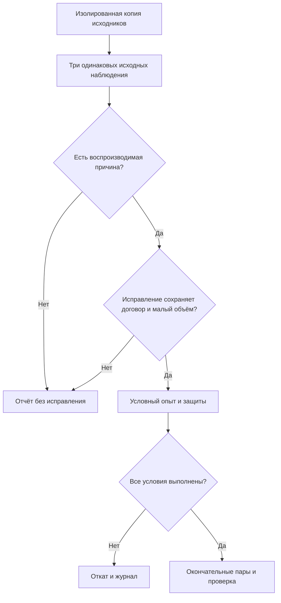
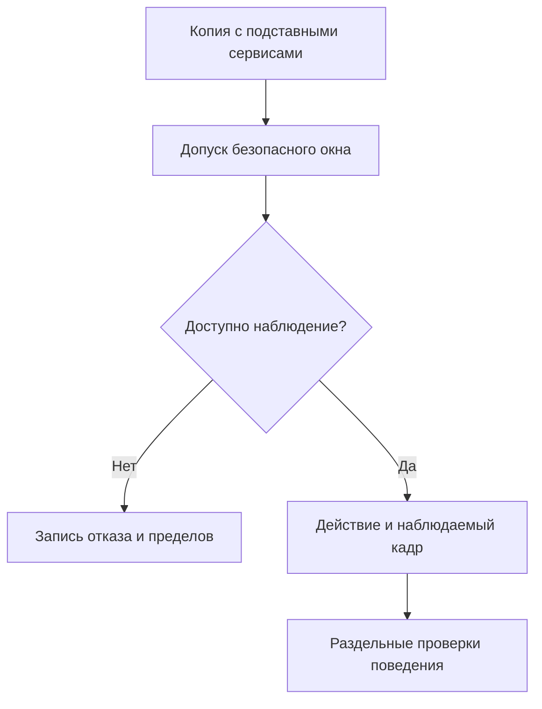
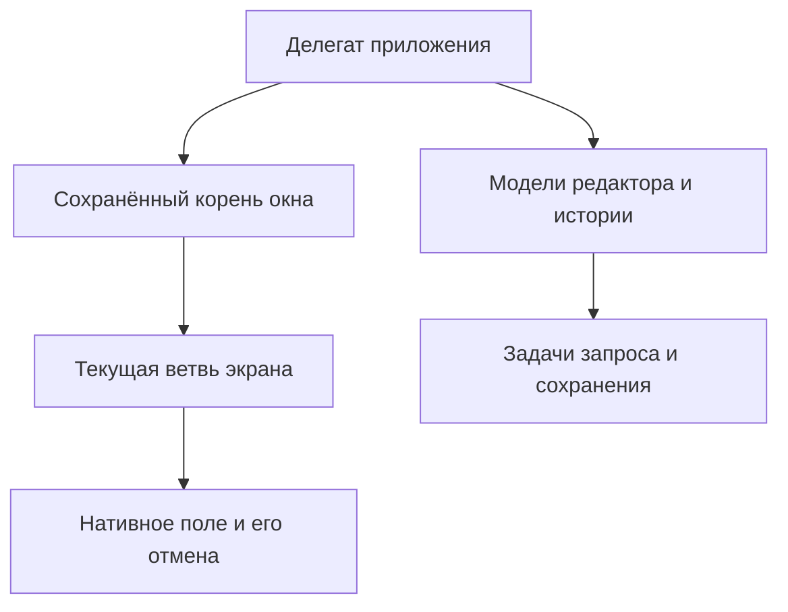

# Причина роста памяти и проверка видимого окна - Plan

## Goal Capsule

- **Цель:** владелец получает проверяемый вывод о росте памяти при повторных действиях и о работе видимого окна; небольшое исправление допускается только при доказанной причине.
- **Способ:** последовательная локальная диагностика и условный опыт (KTD1, KTD2).
- **Приоритет:** требования пользователя, `AGENTS.md`, `DESIGN.md`, условия R1–R8, затем технические решения этого плана.
- **Профиль:** текущая ветка `main`, без платных вызовов приложения, публикации и архитектурного внедрения (R1).
- **Остановка:** недоступное наблюдение либо отсутствие подтверждённой причины завершает соответствующую ветвь выводом с пределами доказательства, без исправления (R3, R4).
- **Приёмка:** основной исполнитель сводит доказательства, проверяет окончательный состав и создаёт локальный коммит; публикация отдельно.

---

## Product Contract

### Summary

Установить, какие действия удерживают память в безопасной копии приложения, и проверить возможность наблюдать её настоящее видимое окно. Испытать небольшое исправление только после атрибуции причины.

### Problem Frame

В предыдущей серии ограниченный цикл одинаковых состояний рос примерно с 127 до 252 МиБ резидентной памяти после 10/50/100 переходов. Занятая куча росла с 38 до 127 МиБ; причина удержания не установлена. Текстовые контейнеры освобождались, явные области освобождения временных объектов и задачи на каждое действие рост не устранили. Это наблюдение подставной оболочки, а не доказанная утечка установленного приложения.

Новая локализация на исходной копии связала основной рост с оставшимися объектами TextKit 2 после уничтожения текстовых представлений. Контроль с настоящим `NSPopover` и создание настроенных нативных полей воспроизводят удержание; точная внутренняя ошибка платформы не доказана. Временное завершение владения текстовым деревом освобождает целевые объекты, но один из трёх диагностических опытов сохраняет рост занятой кучи 16,03%. Это кандидат для проверки, не принятое исправление.

Прежнее окно было перекрыто: локальная раскладка и отправка рисования не подтвердили увиденный кадр. Команда отмены в оболочке не восстановила модель. Без этих границ следующий опыт может принять экономию внутренней работы за улучшение для человека.

### Requirements

**Изоляция и сохранение**

- R1. Исследовать только локальную копию фактических исходников с синтетическими текстами, подставными ключами, провайдером, обновлением, автозапуском и буфером; внешний запрет сети обязателен.
- R2. Сохранить пользовательские рабочие файлы, производственные данные, предыдущие завершённые планы и действующие договоры приложения из `AGENTS.md`, `DESIGN.md` и `docs/research/performance/README.md`.

**Доказательство причины и окна**

- R3. Разделить удерживаемые объекты, полезную отмену, платформенные кеши, фоновые задачи и артефакт оболочки; до доказанного владельца и воспроизводимой причины исправление памяти запрещено.
- R4. Проверить доступность безопасного видимого окна без выдачи разрешений и запуска установленного приложения; при недоступности указать точный отказ и оставить показанный кадр, настоящую отмену, доступность, системный буфер и составной ввод `NOT_PROVEN`.

**Условное исправление и приёмка**

- R5. Разрешено только небольшое локальное исправление доказанной причины с прежним поведением; потоковый вывод, общее владение сессией, отложенный запуск, новые пределы текста/истории/отмены исключены.
- R6. Выигрыш принимается по заранее объявленной основной метрике: пять чередующихся пар, каждое значение после меньше каждого до, медианный выигрыш строго больше `max(10%, (max − min) / median)` исходных значений.
- R7. Каждая сопоставимая пара сохраняет текущую резидентную память в пределах +10%; ограниченный цикл одинаковых состояний после 10/50/100 действий должен выйти на плато, а корректность и соседние действия не ухудшаются.
- R8. Завершить серию отчётом с журналом всех попыток и окончательным сравнением либо откатом; отсутствие исправления является допустимым итогом исследования.

### Key Decisions

- **Сохранить пределы и поведение приложения.** Ограничение полных данных или полезной отмены меняет продукт. Governs R2, R5.
- **Разделить исследование и архитектурные варианты.** Архитектура обсуждается в отдельном досье. Governs R5.

### Acceptance Examples

- AE1. Covers R3, R8. Один и тот же рост есть в исходной версии и причина не атрибутирована: отчёт сохраняет числа, исправления нет.
- AE2. Covers R4. Окно помечено видимым, но перекрыто или нет подтверждённого кадра: локальная длительность не называется временем до кадра.
- AE3. Covers R5–R8. Небольшой опыт ускоряет работу, но память или соседнее действие нарушает защиту: опыт откатывается и остаётся в журнале.

### Scope Boundaries

В текущую работу входят диагностика, ограниченная попытка видимого окна и условный локальный опыт. Новые разрешения системы, реальные ключи/история/сеть и изменение охранных пауз исключены по R1–R5.

#### Deferred to Follow-Up Work

Внедрение архитектуры из отдельного досье, реальные измерения провайдера и оплаты требуют самостоятельного решения владельца. Прототипы с новой политикой удержания скрытого дерева здесь не создаются.

Рассмотрены и не добавлены: дополнительный прогрев для сокрытия роста, очистка памяти перед замером, исключение выбросов, повтор отвергнутых префикса истории, контроля отмены, выделения карточки, `autoreleasepool` и дочерних задач без новой причины. Условия пересмотра — новые первичные данные о конкретном владельце и защищаемом поведении.

---

## Planning Contract

### Key Technical Decisions

- KTD1. **Сначала атрибуция, затем изменение.** Раздельные контрольные пути отличают рост оболочки от удержания, которым владеет приложение; прежние счётчики представлений не охватывают остальные объекты. Governs R3, R5.
- KTD2. **Сначала допуск наблюдения окна.** Наличие процесса или `visible=true` не доказывает, что человек видит кадр. Для допуска нужны неперекрытое окно, безопасные зависимости и работающий способ наблюдения. Governs R1, R4.
- KTD3. **Одна объявленная метрика на причинный опыт.** Резидентная память/занятая куча/счётчик удержанных объектов не подменяют друг друга; начало, конец и одинаковое конечное состояние фиксируются до опыта. До новых пар объявляется числовая проверка плато для RSS и занятой кучи: прирост 50→100 не больше 1% от точки 50 и прирост 10→100 не больше 10% от точки 10. Это новое допущение проверки, а не пересмотр проваленного диагностического опыта. Governs R6–R8.
- KTD4. **Доказательства вне пользовательских данных.** Новый отчёт с собственным журналом хранится в `docs/research/performance/audits/2026-10-14-memory-window.md`; измерительные исходники, хеши и сырые массивы — во временном каталоге серии. Старый незакоммиченный журнал не переписывается. Governs R1, R2, R8.

### High-Level Technical Design

### Assumptions

- Бюджет всех локальных измерительных команд серии — 1800 с; начальная локализация резервирует не более 600 с, остальные проверки используют оставшийся учтённый бюджет.
- Сведения о разрешениях на момент постановки: запись экрана, Accessibility и синтез событий недоступны; здорового моста нет, список доступных приложений не обнаружил копию. Это исходное ограничение, а не обещание получить кадр.
- Размеры 1/10/100 тысяч знаков задают синтетическую лестницу; миллион — отдельно отмеченный стресс. Реальная частота остаётся `NOT_PROVEN`.
- Конкретный файл и тест причины определяются только после U1; это неизвестное исполнения, не разрешение на расширение R5.

### System-Wide Impact

Повторные переходы связывают `PopoverRootView`, `EditorViewModel`, `HistoryStore`, `AlignedTextView` и задачи подтверждения. Изменение владения нельзя принимать по одному освобождённому контейнеру. Сохранение истории, завершение приложения и защита поздних результатов проверяются отдельно; изменение формата данных не входит в план.

### Risks & Dependencies

Инструмент может не получить цепочку удержания или штатный кадр в пределах бюджета. Такой исход выполняет R8 через отчёт с доказанным и недоступным; он не открывает право менять платформу, разрешения или пороги. Для U3 обязательны завершённая атрибуция U1 и все проверки сохранения поведения, которых требует найденная причина.

---

## Implementation Units

### U1. Локализовать рост в одинаковых состояниях

**Цель:** получить воспроизводимый рост и владельца удерживаемой памяти либо ограниченный отрицательный вывод.

**Требования:** R1–R3, R8; Covers AE1. **Зависимости:** нет.

**Файлы:** для чтения `Sources/Rusifikator/App/PopoverCoordinator.swift`, `Sources/Rusifikator/Components/AlignedTextView.swift`, `Sources/Rusifikator/Editor/EditorViewModel.swift`, `Sources/Rusifikator/History/HistoryStore.swift`, `Sources/Rusifikator/History/HistoryView.swift`; запись — отчёт KTD4, временный измеритель.

**Подход:** по KTD1 сравнить полный корень, один редактор, историю/деталь, подтверждение копирования, сохранение и уничтожение корня с одинаковыми данными. Измерять текущую память и занятую кучу, связывать устойчивый прирост с живыми объектами/стеками выделения/цепочками владения доступного инструмента. Промежуточные результаты инструмента не считать установленной причиной.

**Образец:** исходный ограниченный цикл и неудачные диагностические варианты из `docs/research/performance/audits/2026-10-14-local-flow.md`.

**Проверки:**

1. Пять одинаковых пар по 10 тысяч знаков и одинаковые переходы дают сопоставимые 10/50/100 состояния без накопления новых входов.
2. Один и тот же конечный экран и ожидание записи позволяют отделить фоновые операции от постоянного удержания.
3. Уничтожение собственного корня и объявленный интервал обычного простоя не меняют пользовательские данные; сравниваются живые объекты, а не только пик.
4. Сокращённый контроль сохраняет конкретное действие; отсутствие роста в нём локализует границу, но само по себе не назначает причину продукту.

**Верификация:** сырые значения, состояния, исходники/хеши и ограничения инструмента записаны; вывод соответствует R3.

### U2. Проверить допуск и поведение видимого окна

**Цель:** подтвердить доступную часть реального интерфейсного пути безопасной копии.

**Требования:** R1, R2, R4, R8; Covers AE2. **Зависимости:** изоляция U1; локализация причины не обязательна.

**Файлы:** чтение `Sources/Rusifikator/App/AppDelegate.swift`, `Sources/Rusifikator/App/PopoverCoordinator.swift`, `Sources/Rusifikator/Components/AlignedTextView.swift`; запись — отчёт KTD4, временная оболочка.

**Подход:** по KTD2 провести одну ограниченную проверку доступного способа наблюдения и безопасного показанного окна. Отметки запуска до создания значка, конец раскладки/рисования и увиденный кадр вести как разные результаты. Не выдавать новые системные разрешения ради допуска.

**Проверки:**

1. Первое и повторное открытие различены; снимок подтверждает содержимое и неперекрытое состояние, если наблюдение доступно.
2. Вставка, выделение, ползунок до конца, клавиатурная отмена/повтор и составной ввод проверяются в фактическом поле; недоставленное действие помечается отдельно.
3. История → деталь → редактор сохраняет полный текст, пять пар, три строки списка и прежнюю геометрию; копирование подставным сервисом не доказывает системный буфер.
4. Ошибка инструмента, перекрытие или закрытие всплывающего окна дают недоступный исход R4; новые разрешения и запуск установленного приложения отсутствуют.

**Верификация:** доступные действия связаны с наблюдаемыми состояниями; недоступные проверки не заменены снимком невидимого поля.

### U3. Испытать только доказанное малое исправление

**Цель:** сохранить минимальную правку лишь при доказанном улучшении и прежнем поведении.

**Требования:** R2, R3, R5–R8; Covers AE3. **Зависимости:** U1 доказал причину; необходимая проверка поведения из U2 доступна либо причина не зависит от её недоступной части.

**Файлы:** `Sources/Rusifikator/Components/AlignedTextView.swift`; при необходимости нового устойчивого поведенческого покрытия — `Tests/RusifikatorTests/AlignedTextViewTests.swift`. Связанные существующие проверки — `Tests/RusifikatorTests/EditorViewModelTests.swift`, `Tests/RusifikatorTests/HistoryStoreTests.swift`; фактические переходы корня и изображения проверяет временный стенд. Точный набор фиксируется перед опытом в отчёте KTD4; соседняя уборка исключена.

**Подход:** по KTD1 и KTD3 сначала закрепить проявление/характеризацию причины, затем испытать одну правку. Если требуется новая политика удержания, интерфейс, предел или архитектура — завершить без изменения по R5. Для причины оболочки исправлять временный измеритель и повторить исходное наблюдение, не выдавая это за оптимизацию продукта. Для нового кандидата TextKit завершать владение только при уничтожении нативного поля; активное поле, модельный текст, история и прежний срок жизни страницы сохраняются. До изменения проверить, что очистка нативной строки не публикует пустой источник или смену фокуса через координатор, а поздние уведомления не меняют модель. Частичные варианты очистки и провал третьего диагностического опыта остаются отдельными отказами.

**Проверки:**

1. Проявление причины воспроизводится до правки; после неё изменяется доказанный владелец, а конечные данные и состояния совпадают.
2. Отмена, очистка и поздний ответ сохраняют старые переходы; успех добавляет ровно одну полную пару, неудача и отмена не записывают результат.
3. История сохраняет пять полных пар, асинхронную запись, защиту поколений и ожидание завершения.
4. Переносы, ползунок, доступность, фокус и отмена проверяются при затронутом поле; недоступная обязательная защита запрещает принятие.
5. Пары и циклы удовлетворяют R6–R7; провал приводит к откату с сохранением неудачных данных.

**Верификация:** условие принятия выполнено целиком либо исходники восстановлены к исходному снимку.

### U4. Завершить доказательство и состав

**Цель:** передать итог, который проверяется без текущей сессии.

**Требования:** R2, R8. **Зависимости:** U1–U3 завершили свои применимые ветви.

**Файлы:** отчёт KTD4; этот план меняется только для исправления фактического противоречия, не для хранения прогресса.

**Ожидание тестов:** новых тестов поведения нет — единица оформляет результаты.

**Подход:** записать исходный/окончательный состав, учёт времени, все попытки и границы доказательства. У принятой правки провести окончательные пары на финальном коде после упрощения и просмотра; у отката подтвердить побайтное восстановление затронутых исходников. Удалить только созданные воспроизводимые сборки по согласованной гигиене, сохранить исходники и данные доказательства.

**Верификация:** R8 выполнено; пользовательские рабочие файлы сохранены; окончательный состав не содержит отвергнутого кода.

---

## Verification Contract

Принятие определяется R6–R7, а не промежуточным ускорением. Исходные наблюдения — не менее трёх; скрытый дополнительный прогрев, очистка памяти и исключение выбросов запрещены. Соседние открытия/деталь/копирование оцениваются по прежнему правилу разброса без смены метрики после опыта.

После изменения кода обязательны `swift build`, `swift test`, проверка разностей и свежий просмотр затронутого поведения. Стандартный набор `CredentialStoreTests` отдельно от измерительных процессов проверяет настоящий Keychain только с собственными синтетическими ключами и уникальными UUID в service/account, удаляя свои элементы при завершении. Это существующая обязательная проверка проекта; производственные ключи и настройки не читаются, набор не фильтруется и не переписывается ради изоляции измерителей. Если меняются ресурсы или метаданные, применяются упаковка и проверка приложения из `AGENTS.md`; таких изменений план не предполагает. Настоящий интерфейсный кадр, отмена, доступность, составной ввод, системный буфер, провайдер и денежные расходы остаются `NOT_PROVEN`, пока соответствующее первичное доказательство отсутствует.

---

## Definition of Done

- U1 даёт локализацию с первичными данными либо явно ограниченный отрицательный итог.
- U2 даёт наблюдаемые результаты доступных действий либо подтверждённую недоступность по R4.
- U3 даёт правку, принятую по R5–R7, либо отсутствие правки/полный откат с журналом.
- U4 даёт окончательный отчёт, проверенный состав и учёт доказательств; отвергнутый код отсутствует.
- R1–R8 сохраняются; окончательное утверждение об ускорении относится только к проверенной метрике и среде.

### Sources & Research

- `docs/research/performance/audits/2026-10-14-local-flow.md`: рост ограниченного цикла, отсутствие атрибуции, неудачи видимого окна/отмены, откат карточки.
- `docs/research/performance/audits/2026-10-14-fixes.md`: сохранённая защита нулевой ширины и отвергнутые подходы.
- `docs/research/performance/README.md`, `docs/research/performance/journal.md`: методика и охранные условия.
- `AGENTS.md`, `DESIGN.md`: договоры и геометрия интерфейса.
