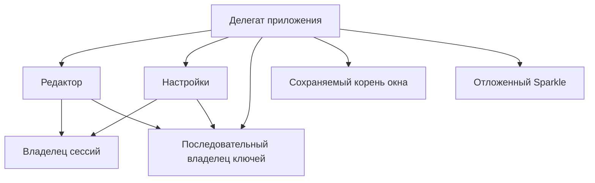
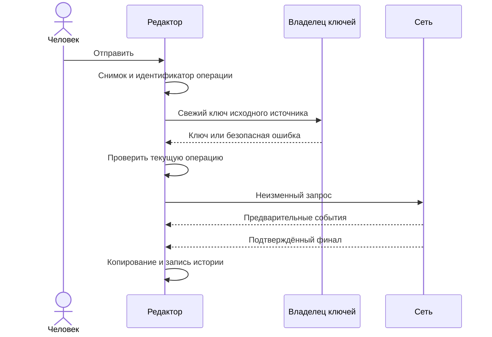
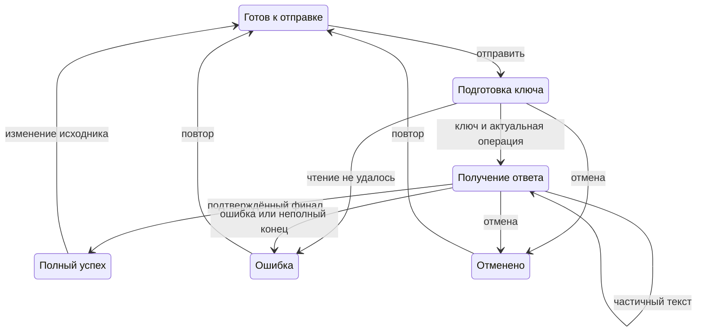
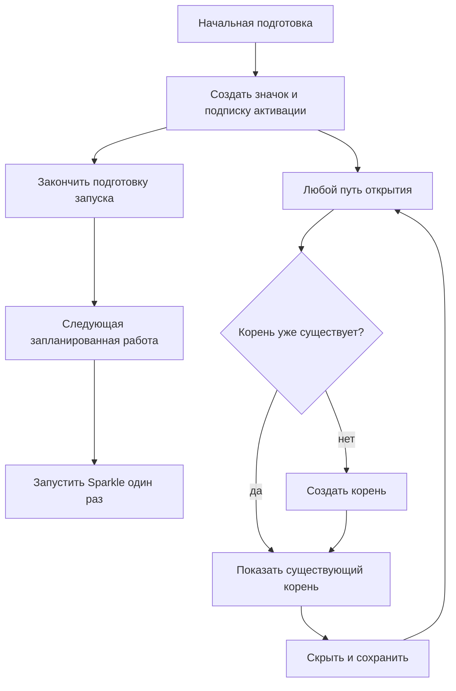
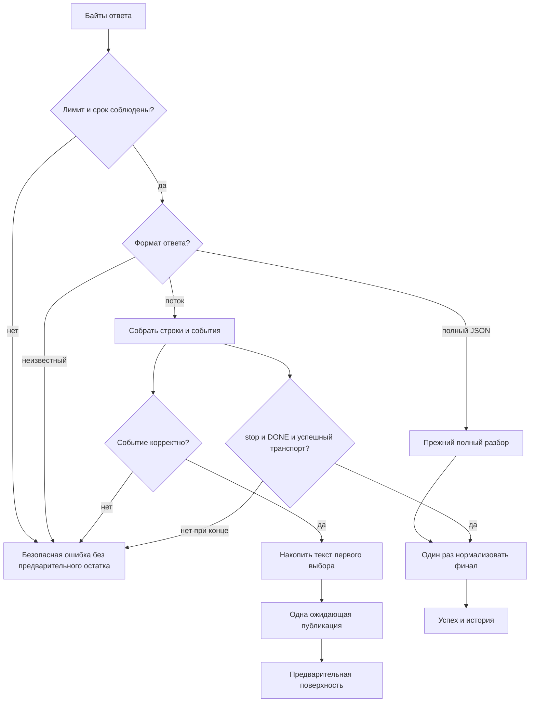
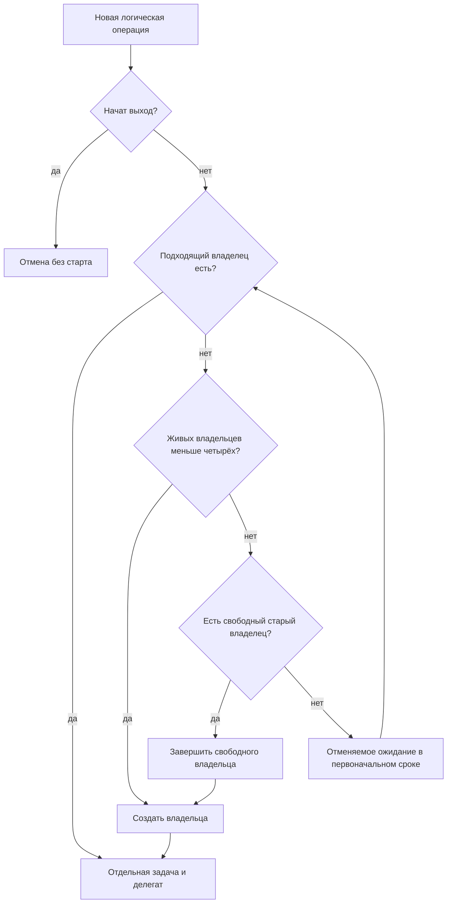

# Раннее чтение результата и отзывчивая подготовка приложения - Plan

## Goal Capsule

**Objective:** Человек может начать читать обработанный текст до конца ответа, отменить подготовку без зависания интерфейса и пользоваться приложением с сохранённым окончательным результатом.

**Means:** Внедрить пять направлений из архитектурного исследования через владельцев запроса, ключей, сетевых сессий и запуска, описанных в KTD1–KTD7.

**Authority:** Последняя просьба владельца внедрить изменения, затем `AGENTS.md`, `DESIGN.md` и этот договор; `docs/research/performance/architecture-options.md` и прежний план досье остаются историческими исследовательскими входами.

**Execution profile:** Локальная реализация в текущей `main` с синтетическими данными и запретом сети измерителя; координатор завершает интеграцию, независимое ревью, итоговые проверки, измерения и коммит текущей ветки. Публикация отсутствует.

**Stop conditions:** Утечка текста/ключа, лишний POST, неверная история, нарушение отмены/срока или повреждение пользовательских изменений останавливает затронутый опыт. Провал принятого числового критерия требует исправить вариант или вернуть его и записать отрицательный результат.

---

## Product Contract

### Summary

Добавить включаемый частичный показ ответа и сохранить привычную обработку целого ответа. Читать свежий ключ вне главного потока и повторно использовать ограниченное число безопасных сетевых сессий. Создавать корень окна один раз при первом открытии, а Sparkle запускать после начальной подготовки независимо от открытия окна.

### Problem Frame

Сейчас редактор ничего не показывает до полного ответа, а подготовка настроек обращается к блокирующему Keychain на главном потоке. Перед созданием значка приложение создаёт скрытый корень окна и запускает службу обновлений. Исследование установило эти границы владения, но ещё не подтвердило ускорение реального провайдера или показанного кадра.

### Key Decisions

- **Внедрить все пять направлений:** владелец потребовал работающие изменения и итоговый отчёт после уточнения границы прежнего досье. Governs R1, R5, R7, R9, R10. (session-settled: user-directed — chosen over another read-only dossier: owner requested implementation and final report)
- **Совместимость сохраняется ручным выбором режима:** отсутствие доказанной поддержки потока у посредника не разрешает повторно отправлять оплачиваемый запрос. Governs R1, R4.
- **Копирование означает окончательный успех:** предварительный текст не превращается в сохранённый результат. Governs R2, R3.

### Requirements

**Обработка и предварительный показ**

- R1. Настройки содержат сохраняемый выбор частичного показа, по умолчанию выключенный для существующих и новых установок; выключенный режим сохраняет нынешний полный ответ.
- R2. При включённом режиме редактор показывает накопленный предварительный текст в состоянии обработки, явно сообщает о незавершённости и разрешает копирование только подтверждённого финала, включая стандартные команды и меню выделения.
- R3. Отмена, очистка, ошибка и неподтверждённый конец потока убирают предварительный текст; история получает ровно одну полную пару только при окончательном успехе.
- R4. Корректный полный JSON, полученный вместо потока в той же попытке, принимается существующим полным разбором без предварительного показа и повторного POST. Ответ, несовместимый с обоими форматами, завершается безопасной ошибкой с возможностью вручную выключить режим перед новой отправкой; автоматического повторного POST для смены режима нет.
- R5. Каждая обработка замораживает исходник и применённые адрес/модель/режим до ожидания ключа, читает свежий ключ для этого источника и затем сохраняет неизменный сетевой снимок.
- R6. Повторное нажатие запрещено во время подготовки и получения ответа; отмена подготовки исключает запуск сети после позднего чтения ключа, а устаревший фрагмент или финал не меняет новую операцию.

**Сетевое и секретное владение**

- R7. Ограниченный владелец повторно использует временные сессии, сохраняя независимое тело, заголовок ключа, разрешённый источник, отмену и результат каждой задачи.
- R8. Соблюдаются сетевые и секретные договоры `AGENTS.md` и `docs/research/performance/README.md`; общий лимит тела 4 МиБ включает служебные байты потока, сроки обработки/проверки 90/30 секунд не возобновляются на фрагменте или повторе, допустим один TLS-повтор с прежней паузой 0,5 секунды только до получения данных.
- R9. Чтение, сохранение и сброс ключей последовательны вне главного потока; откат пары ключ/источник сохраняется, а выход ожидает начатые записи.
- R14. Успешная запись ключа применяет соответствующий снимок адреса/модели/режима даже после нового ввода в черновик; новый черновик сохраняется, а зависимые действия не видят промежуток между ключом и применёнными настройками.
- R15. Подготовка ключа имеет отдельное отменяемое объяснение без обещания общего предела 90 секунд; этот срок относится к сетевой части R8.
- R16. Начало выхода запрещает новые чтения/отправки и отложенный старт обновлений, отменяет активные сетевые операции и ожидает только уже начатые записи ключей и истории, затем завершает владельцев.

**Запуск и интерфейс**

- R10. Корень окна создаётся ровно один раз при первом открытии через щелчок, настройки, повторное открытие или активацию вторичным экземпляром и сохраняется при скрытии.
- R11. Sparkle запускается после завершения начальной подготовки даже без открытия окна; подготовка, готовность и отсутствие механизма в сборке различимы, ручная проверка до готовности не вызывает службу.
- R12. Геометрия `DESIGN.md`, исходное редактирование, пятиэлементная история и очистка после 120 секунд скрытия сохраняются; активная подготовка/обработка переживает скрытие, как нынешний запрос.
- R13. Итог содержит реальные сопоставимые локальные числа для каждого направления и границы доказательства; пользовательские исходные изменения и исторические документы сохранены.

### Acceptance Examples

- AE1. Covers R2, R3: после первого текстового события предварительный результат читается, кнопка копирования неактивна и история пуста; подтверждённое завершение даёт нормализованный полный результат и одну запись.
- AE2. Covers R3, R6: после отмены A и запуска B запоздалый ключ, фрагмент или финал A не запускает POST и не меняет B.
- AE3. Covers R5, R9: обработка, начатая для A, сохраняет исходный снимок при сохранении настроек B; следующая обработка читает новый ключ для B.
- AE4. Covers R7, R8: отмена запроса редактора не отменяет параллельную проверку подключения; небезопасное перенаправление не отправляет ключ второму источнику.
- AE5. Covers R10, R11: ни одного открытия окна не было, но отложенная подготовка запускает Sparkle один раз; первое открытие настроек создаёт единственный корень нужной страницы.
- AE6. Covers R9: ошибка записи источника после ключа восстанавливает прежнюю пару и не меняет применённый адрес/модель/режим.

### Scope Boundaries

В работе пять направлений с поведением и защитами R1–R12, R14–R16 и доказательствами R13. Ресурсы, системная инструкция, версия, упаковка, политика единственного экземпляра и редактируемое нативное поле не меняются.

**Considered and not built:** автоматический выбор режима по ошибке требует неоднозначного повторного POST и нарушает R4; кеш ключа нарушает R5; уничтожение корня при скрытии затрагивает отмену/составной ввод и не проходит прежние защиты памяти. Прямое дописывание в нативное текстовое хранилище не требуется для R2, пока ограниченное объединение публикаций проходит измерения.

**Deferred to Follow-Up Work:** совместимость и оплачиваемая скорость реального посредника, фактическое повторное TCP/TLS-соединение, системная цена Keychain, показанный композитором кадр и настоящее расписание Sparkle требуют отдельного разрешённого опыта. Их отсутствие не превращает числа подставных служб в реальные.

---

## Planning Contract

### Assumptions

Фактическая пользовательская нагрузка неизвестна: используется объявленный синтетический корпус. Значения частичного режима и политики финала в R1–R4 выбраны как безопасные совместимые значения для этой реализации. Сведения о системных разрешениях из прежнего аудита не дают новых разрешений: локальная нативная проверка выполняется без их изменения.

### Key Technical Decisions

- KTD1. **Разделить предварительный и окончательный текст:** отдельное наблюдаемое поле предварительного результата с идентификатором операции и не более одной ожидающей публикацией; окончательная нормализация остаётся однократной. Для R1–R4 промежуточная поверхность не допускает выделение и стандартное копирование. Использовать отдельную невыделяемую прокручиваемую поверхность, сохраняя окончательное поле и исходный ввод.
- KTD2. **Владелец сессий с границей источника и политики:** не более четырёх живых владельцев по нормализованному HTTPS-источнику и фиксированной политике 30/90 секунд, что покрывает две текущие параллельные операции с двумя источниками/политиками без общего неограниченного пула; простаивающий старый владелец закрывается, активный заканчивает свои задачи перед закрытием. Для R7–R8 назначить проверенный SDK делегат отдельной задачи до её запуска, не использовать completion-handler доставку вместо фрагментов. Если все четыре владельца заняты, отменяемое ожидание допуска расходует текущий абсолютный бюджет и не вытесняет чужую задачу; абсолютный срок принадлежит логической операции и включает ожидание владельца и TLS-паузу. Ключ отсутствует в идентификаторах владельца и заново создаётся в каждом заголовке.
- KTD3. **Последовательный асинхронный владелец ключей:** backend принадлежит одному исполнителю вне главного потока с проверяемым владением Swift 6; блокирующая операция не содержит ожиданий, через которые могла бы вклиниться другая запись. Владелец исполняется на частном последовательном исполнителе с очередью Dispatch, а не блокирует совместный пул Swift. Для R5–R6 и R9 редактор резервирует операцию до чтения; состояние загрузки охватывает подготовку с отдельной фазой R15. Не использовать `unchecked Sendable` для переноса непроверенного хранилища. По R14 одна запись настроек охватывает ключ и применение снимка: save/reset/discard/submit временно не запускаются параллельно ей, поля черновика остаются редактируемыми. Успешная запись обновляет применённые значения всегда, а черновик и закрытие экрана — только если его поколение не изменилось.
- KTD4. **Ленивый сохраняемый контроллер:** лёгкая оболочка всплывающего окна создаётся при запуске, единственный центральный путь показа устанавливает `NSHostingController` до первого `show`. Для R10 и R12 модели остаются у делегата приложения, скрытие не освобождает дерево.
- KTD5. **Отдельная готовность обновлений:** создать/запустить Sparkle в запланированной следующей работе после готовности начальной подготовки. Для R11 этот путь не обращается к показу окна и отменяется при завершении приложения; `startingUpdater: false` и однократный явный запуск сохраняют владельца расписания Sparkle.
- KTD6. **Строгий протокол только нового режима:** байтовый разбор SSE переживает любую границу UTF-8 и LF/CRLF, комментарии и несколько строк `data`; первый выбор `index: 0` принимает текстовые `delta`, служебные пустые события игнорируются. Успех потока требует текст, `finish_reason: stop`, `[DONE]` и успешное завершение транспорта; `length`, фильтр, инструменты, ошибочный JSON или конец без маркера дают R3. Поддерживаются CR, LF, CRLF и начальный BOM; лимит одного события 1 МиБ, накопленного результата 4 МиБ, суммарное тело ограничено R8. Тип `text/event-stream` разбирается как поток, а корректный `application/json` той же попытки — прежним полным разбором без повторной отправки. Неизвестный тип или повреждённое тело дают R4. Текст после принятого stop/DONE считается повреждённым завершением. Полный JSON сохраняет прежнюю семантику без общего ужесточения.
- KTD7. **Общие зависимости устанавливаются в приложении:** редактор и проверка настроек используют один сетевой владелец, настройки и редактор — один владелец ключей. Это даёт действительное переиспользование и последовательность R7/R9, которые отдельные значения по умолчанию не обеспечивают.

### High-Level Technical Design

Владение компонентами (KTD1–KTD5, KTD7):

Порядок подготовки и ответа (R5–R6, KTD3):

Состояния редактора (R2–R6):

Жизнь оболочки и служб (R10–R11):

Разбор данных и решений (KTD6, R3, R8):

Допуск владельца сессии (KTD2):

Сочетания режимов и доступности (R1, R2, R11) независимы; ниже приведены пять примеров, а не запрещены остальные сочетания:

| Режим | Поверхность во время обработки | Копирование | Состояние обновлений | Ручная проверка |
|---|---|---|---|---|
| Полный ответ | Прежнее ожидание | После успеха | Подготовка | Выключена |
| Частичный, до текста | Ожидание | Выключено | Подготовка | Выключена |
| Частичный, есть текст | Явный предварительный текст | Выключено | Готовность | По готовности Sparkle |
| Частичный, подтверждённый финал | Готовый текст | Включено | Готовность | По готовности Sparkle |
| Любой, ошибка/отмена | Ошибка/отмена без остатка | Выключено | Недоступно в сборке | Выключена |

### System-Wide Impact

Смена асинхронного договора затрагивает инициализацию настроек, сохранение, сброс, выход и путь от кнопки до сети. Поздняя загрузка начального ключа не должна перезаписать уже введённый черновик. Смена черновика отменяет проверку подключения, но не начатый неизменный запрос редактора; исходные проверки этих порядков становятся асинхронными, сохраняя смысл.

Отмена задачи перестаёт инвалидировать общую сессию. При завершении приложения нужно дождаться записей истории и ключей, запретить новые операции и завершить сетевых владельцев. Просмотр настроек до готовности служб остаётся допустимым.

### Risks and Dependencies

Документация OpenAI подтверждает формат изготовителя, но не посредника: R4 сохраняет ручной выход. Неограниченная очередь предварительных публикаций и удержание делегата сессией требуют KTD1/KTD2. Точность системной отмены и составного ввода защищается сохранением исходного редактируемого поля, а не вмешательством в TextKit.

Блокирующий вызов внутри `Task`, унаследовавшего главный исполнитель, не выполняет R9: необходима проверка фактического потока и отзывчивости. Изменение счётчиков создания сессий не доказывает повторного TCP-соединения. Перенос работы запуска не доказывает более ранний видимый значок без проверки кадра.

### Sources and Research

Текущие владельцы и проверки описаны в `docs/research/performance/architecture-options.md`; отрицательный опыт TextKit остаётся в `docs/research/performance/audits/2026-10-14-memory-window.md`. Правила измерений принадлежат `docs/research/performance/README.md` и `journal.md`.

Для KTD1/KTD6 используется [официальный формат потоковых Chat Completions](https://developers.openai.com/api/reference/resources/chat/subresources/completions/streaming-events). Для KTD2 — [владение URLSession](https://developer.apple.com/documentation/foundation/urlsession) и [завершение владельца после задач](https://developer.apple.com/documentation/foundation/urlsession/finishtasksandinvalidate()). Для KTD3 — [блокирующее чтение Keychain](https://developer.apple.com/documentation/security/secitemcopymatching(_:_:)). Для KTD5 — [программная подготовка Sparkle](https://sparkle-project.org/documentation/programmatic-setup/). В macOS SDK свойство [делегата задачи](https://developer.apple.com/documentation/foundation/urlsessiontask/delegate) доступно до resume, что обосновывает KTD2 вместо общего маршрутизатора. Для KTD3 [WWDC22](https://developer.apple.com/videos/play/wwdc2022/110350/) обосновывает частную Dispatch-очередь для блокирующих вызовов. В `Package.resolved` закреплён Sparkle 2.9.4: стандартный `startUpdater()` не возвращает ошибку, поэтому готовность означает установленный этап запуска, а отказ в callback отображается безопасно. Изменение `canCheckForUpdates` наблюдается отдельно, чтобы временный отказ Sparkle не оставил кнопку навсегда выключенной. Ошибку не следует выдумывать как возвращаемый результат метода.

---

## Implementation Units

### U1. Безопасное повторное использование сессий

**Goal:** Последовательные обработки используют одного владельца с независимой отменой.

**Requirements:** R7, R8, R13; Covers AE4.

**Dependencies:** Нет; исходные сетевые тесты характеризуют защищаемое поведение до замены владельца.

**Files:** `Sources/Rusifikator/Networking/OpenAICompatibleClient.swift`; новый `Sources/Rusifikator/Networking/NetworkSessionOwner.swift`; `Sources/Rusifikator/Networking/NetworkDiagnosticEvent.swift` только для безопасных счётчиков/категорий; `Tests/RusifikatorTests/APIClientTests.swift`; новый `Tests/RusifikatorTests/NetworkSessionOwnerTests.swift`; подключение в `Sources/Rusifikator/App/AppDelegate.swift`.

**Approach:** Перенести владение сессией из отдельного обработчика попытки к владельцу KTD2. Отдельный обработчик сохраняет буфер, продолжение, источник и счётчики задачи; callbacks завершаются вне блокировки. Для полного ответа сохраняется нынешний разбор. Приложение внедряет общий клиент по KTD7.

**Execution note:** Сначала получить падающую проверку повторного использования и отмены соседней задачи; старые ограничения остаются зелёными после интеграции.

**Patterns to follow:** Нынешние `StreamingRequest.finish`, `ProviderOrigin.permits`, `retryTimeout` и проверки перенаправлений в `APIClientTests.swift`.

**Test scenarios:**

1. Сто последовательных запросов одного источника дают одно создание сессии для одной политики и пустое активное владение после каждого завершения.
2. Covers AE4. A отменён во время одновременного B: B успешно заканчивается, каждое продолжение завершено один раз.
3. Два источника и политики 30/90 получают разные владельцы; переходы за предел четырёх не инвалидируют активную чужую задачу.
4. Ротация ключа меняет только заголовок следующего запроса, сохраняя изоляцию тела и разрешённый источник старого.
5. Небезопасный редирект, 4 МиБ+1 без правдивой длины, тайм-аут, отмена и TLS-повтор проходят прежние договоры R8; серия фрагментов не обновляет абсолютный срок.
6. После закрытия владельца новые задачи не принимаются, активные заканчиваются и делегаты/сессии перестают удерживаться; завершение приложения не оставляет реестр.

**Verification:** Счётчики фактических владельцев и тестовые события подтверждают KTD2, результат M2 проходит общий числовой критерий, APIClientTests сохраняют защищаемые границы.

### U2. Свежее чтение ключа без блокировки редактора

**Goal:** Подготовка обработки не блокирует главный поток и поддерживает отмену.

**Requirements:** R5, R6, R9, R12–R16; Covers AE2, AE3, AE6.

**Dependencies:** U1 для общего сетевого подключения; сам владелец ключей может разрабатываться независимо.

**Files:** `Sources/Rusifikator/Security/CredentialStore.swift`; новый `Sources/Rusifikator/Security/AsyncCredentialStore.swift`; `Sources/Rusifikator/Settings/SettingsView.swift`; `Sources/Rusifikator/Editor/EditorViewModel.swift`; `Sources/Rusifikator/App/AppDelegate.swift`; `Tests/RusifikatorTests/CredentialStoreTests.swift`; новый `Tests/RusifikatorTests/AsyncCredentialStoreTests.swift`; `Tests/RusifikatorTests/SettingsViewModelTests.swift`; `Tests/RusifikatorTests/EditorViewModelTests.swift`.

**Approach:** Владелец KTD3 принимает свежее чтение/запись/удаление, а настройки переводят начальное чтение и действия на его асинхронный договор. Идентификатор начальной загрузки и поколение черновика исключают позднюю подмену введённого ключа. Редактор начинает и резервирует подготовку сам, затем получает ключ и запускает запрос только для текущего идентификатора. Запись и применение снимка следуют R14, закрытие страницы ждёт завершения и не уничтожает новый черновик. Выход устанавливает барьер R16 до ожидания записи вместе с историей.

**Execution note:** Сначала доказать красным наблюдением блокировку главного потока на управляемом backend, потом проверить сериализацию и отмену до сети.

**Patterns to follow:** Откат `KeychainCredentialStore.saveAPIKey`, свежесть `SettingsViewModelTests.testSubmitReloadsKeyForCurrentStoredOrigin`, UUID редактора, поколения асинхронной истории.

**Test scenarios:**

1. Заблокированный синтетический backend выполняется вне главного потока, пока контрольное действие главного исполнителя завершается.
2. Covers AE2. Ключ A возвращается после отмены/очистки и нового B: сеть A не вызывается, данные B не меняются.
3. Covers AE3. Источник, модель и исходник заморожены перед чтением; сохранение B не меняет начатый A, следующий запрос читает B заново.
4. Covers AE6. Сбой второй записи сохраняет прежние ключ/источник и применённые настройки; очередное чтение видит целую пару.
5. Неправильный источник/отсутствующий ключ/сбой чтения сохраняют безопасную ошибку и не раскрывают секрет.
6. Начальная загрузка и поздний возврат после discard/reset не перезаписывают новый черновик; два save/reset не завершаются вне своего порядка.
7. Сохранение → правка черновика применяет успешный снимок, сохраняет новый ввод и оставляет страницу открытой; сохранение → сброс/отправка не видит неполного сочетания ключа и адреса.
8. Выход с ожидающей записью дожидается её результата; закрытое окно на 120 секунд с подготовкой не сбрасывает активную операцию.
9. Реальные `CredentialStoreTests` сохраняют отдельный UUID-префикс для созданных и удалённых синтетических записей, пользовательская служба не используется.

**Verification:** M3 измеряет отзывчивость и фактическое выполнение backend; все прежние проверки настроек сохраняют смысл после асинхронного перехода.

### U3. Частичный показ с подтверждённым финалом

**Goal:** Включённый режим публикует читаемый фрагмент до полного результата.

**Requirements:** R1–R6, R8, R12, R13, R15, R16; Covers AE1, AE2.

**Dependencies:** U1, U2; выделенный декодер можно проверить независимо.

**Files:** `Sources/Rusifikator/Networking/APIModels.swift`; новый `Sources/Rusifikator/Networking/StreamingResponseDecoder.swift`; `Sources/Rusifikator/Networking/OpenAICompatibleClient.swift`; `Sources/Rusifikator/Editor/EditorViewModel.swift`; `Sources/Rusifikator/Editor/EditorView.swift`; `Sources/Rusifikator/Settings/SettingsStore.swift`; `Sources/Rusifikator/Settings/SettingsView.swift`; `Tests/RusifikatorTests/APIClientTests.swift`; новый `Tests/RusifikatorTests/StreamingResponseTests.swift`; `Tests/RusifikatorTests/EditorViewModelTests.swift`; `Tests/RusifikatorTests/SettingsStoreTests.swift`; `Tests/RusifikatorTests/SettingsViewModelTests.swift`; `DESIGN.md`; `README.md`; `README.en.md`.

**Approach:** Декодер KTD6 отделяет транспортные байты от предварительного текста и финала. Редактор KTD1 публикует только последнее накопленное значение текущей операции и сохраняет старый полный путь. Настройки добавляют выбор R1, описание несовместимости следует R4. Представление сохраняет высоту поверхности и не меняет редактируемое поле; предварительная поверхность KTD1 не использует выбираемое финальное поле.

**Execution note:** Сначала проверить каждую границу декодера и потерянный финал; затем падающее наблюдение первого фрагмента, отключённого копирования и пустой истории до успеха.

**Patterns to follow:** Финальная нормализация клиента, `activeRequestID`, история только в `finish`, существующая поверхность только для чтения результата и визуальные правила `DESIGN.md`.

**Test scenarios:**

1. Covers AE1. Синтетический поток с кириллицей, эмодзи, абзацами и наружными кавычками публикует сырой предварительный текст и один нормализованный финал.
2. Для CR/LF/CRLF и начального BOM, каждого байтового разреза UTF-8, нескольких событий в callback, комментариев, пустых delta и нескольких `data:` результат совпадает с непрерывной доставкой.
3. `length`, `content_filter`, tool calls, повреждённый JSON, неожиданный выбор и EOF без подтверждения не становятся успехом и очищают предварительное поле.
4. Covers AE2. Поздний фрагмент и отложенная публикация отменённого A не восстанавливают текст и не портят B.
5. Ровно допустимый размер и превышение одного байта, HTTP-ошибка до данных, ошибка после текста и медленное непрерывное тело сохраняют R8; корректный полный JSON той же попытки даёт финальный успех, несовместимый ответ — ошибку, оба без повторного POST.
6. Один поток с тысячами микрофрагментов держит не более одной ожидающей публикации; финал не теряется при её отмене/объединении.
7. Полный режим отправляет прежнее тело с `stream: false`, сохраняет прежнюю нормализацию и поведение непустого полного JSON; reset/discard/save сохраняют выбранный режим правильно.
8. Предварительная поверхность прокручивается и читается, но не даёт выделение, ⌘C или копирование из меню; исходный фокус/выделение/отмена не меняются, скрытие не прерывает запрос.

**Verification:** M1 показывает первое наблюдаемое предварительное значение до полного результата по тому же расписанию; полный результат, история и лимиты проходят защиту.

### U4. Единственный корень при первом открытии

**Goal:** До первого открытия приложение не создаёт невостребованный корень окна.

**Requirements:** R10, R12, R13; Covers AE5.

**Dependencies:** U2 для готовности моделей; U3 для окончательного состава корня.

**Files:** `Sources/Rusifikator/App/AppDelegate.swift`; `Sources/Rusifikator/App/PopoverCoordinator.swift` при выделении проверяемого владельца; новый `Tests/RusifikatorTests/AppLaunchTests.swift`; прежние `Tests/RusifikatorTests/SingleInstanceTests.swift` и `Tests/RusifikatorTests/EditorViewModelTests.swift` как регрессии.

**Approach:** Отделить оболочку `NSPopover` от установки содержимого и централизовать KTD4 в имеющемся `showPopover`. Проверяемая фабрика или узкий владелец запуска считает реальные создания; скрытие оставляет прежний контроллер.

**Execution note:** До правки зафиксировать счётчик прежнего создания; затем получить падающую проверку отсутствия корня до открытия и одного создания на все входы.

**Patterns to follow:** Нынешние `showPopover`, `openSettings`, `applicationShouldHandleReopen`, `activateFromAnotherInstance`.

**Test scenarios:**

1. До создания значка/после завершения запуска корень не существует, модели и обработчик вторичной активации доступны.
2. Первый щелчок создаёт один нативный hosting-контроллер; второе открытие после скрытия использует ту же идентичность.
3. Covers AE5. Первым действием является открытие настроек, повторное открытие приложения либо вторичная активация: единственный корень показывает правильную страницу.
4. Скрытие во время подготовки/потока не уничтожает контроллер и не меняет запрос; короткое открытие и правило 120 секунд сохраняют R12.

**Verification:** M4 подтверждает нулевую работу создания корня перед значком и одну работу первого открытия; нативное содержимое/геометрия проверены без вмешательства в исходный TextKit.

### U5. Отложенный независимый запуск Sparkle

**Goal:** Начальная подготовка заканчивается до старта обновлений, которые работают и без открытия окна.

**Requirements:** R11, R12, R13, R16; Covers AE5.

**Dependencies:** U2, U4 для окончательного порядка запуска/завершения приложения.

**Files:** `Sources/Rusifikator/App/AppDelegate.swift`; `Sources/Rusifikator/Updates/SparkleUpdaterService.swift`; `Sources/Rusifikator/Updates/UpdateViewModel.swift`; `Sources/Rusifikator/Updates/UpdateState.swift`; `Sources/Rusifikator/Settings/SettingsView.swift`; `Tests/RusifikatorTests/UpdateTests.swift`; `Tests/RusifikatorTests/AppLaunchTests.swift`; `README.md`; `README.en.md`.

**Approach:** Механизм KTD5 публикует готовность независимо от корня окна. Подставная фабрика/scheduler проверяет реальный порядок подключения, а настоящий Sparkle использует существующие delegate bridge и gentle reminders. Запланированная работа имеет идентификатор и проверяет завершение приложения.

**Execution note:** Сначала проверить отсутствие старта до завершения начальной подготовки и один старт без первого открытия; не обращаться к действительному feed ради теста.

**Patterns to follow:** `UpdateViewModel.attach`, обработка `UpdateReport`, существующее отличие занятого checker, `SparkleDelegateBridge`.

**Test scenarios:**

1. Covers AE5. Начальная подготовка закончилась и окно ни разу не открыто: следующий запланированный этап создаёт/запускает службу один раз.
2. В настройках до готовности отображается подготовка, ручная проверка выключена; сборка без механизма сохраняет отдельное прежнее объяснение.
3. Повторные открытия/активации не создают второй updater и не делают дополнительные проверки.
4. Отложенный запуск при начатом выходе отменяется; ошибка старта отображается безопасно, без состояния ложной готовности.
5. После готовности busy/checking, найденная версия, отсутствие обновления, отмена пользователем и ошибка сохраняют прежние UpdateTests; изменение доступности Sparkle обновляет кнопку без открытия другого экрана.

**Verification:** M5 подтверждает порядок на фактическом координаторе запуска и один вызов службы без открытия; настоящее сетевое расписание обозначено отдельной границей.

---

## Verification Contract

### Predeclared Measurements

Методика и общий порог принадлежат `docs/research/performance/README.md`. До первой производственной правки один исполнитель фиксирует декларацию, среду, исходный коммит, корпус, метрики и защиты. Для каждой метрики: не менее трёх исходных наблюдений, пять чередующихся пар исходной и итоговой реализации; полезный медианный эффект строго больше `max(10%, (max − min) / median)` исходных значений. Все пары сохраняются. Числа снимаются с реального локального кода/счётчиков, а расписание синтетического транспорта обозначается как синтетическое.

| ID | Фиксированная нагрузка и конец основной метрики | Защита соседнего поведения | Что число не доказывает |
|---|---|---|---|
| M1 / U3 | Одинаковый синтетический ответ с событиями в заранее заданных моментах; кнопка → первое непустое предварительное значение модели, против кнопка → полный результат исходника | Одинаковый финальный текст; полное завершение, процессор и текущая память не хуже порога защиты; максимум одна ожидающая публикация | Скорость посредника, показанный кадр и цена |
| M2 / U1 | Сто последовательных локальных ответов одного источника/политики; число фактических созданий сессий, число живых владельцев после каждой задачи | Не более четырёх владельцев; независимая отмена/лимиты; пустые активные записи после конца; текущая память при 10/50/100 действиях не добавляет устойчивого роста | Реальное повторное TCP/TLS-соединение |
| M3 / U2 | Одинаковый управляемо заблокированный backend; задержка контрольного действия главного исполнителя и признак выполнения backend на главном потоке | Свежесть, целая ключ/источник пара, отсутствие POST после отмены, один результат записи | Реальная системная длительность Keychain |
| M4 / U4 | Один запуск, первое и второе нативное открытие; число/время создания hosting-корня до значка, при первом и втором открытии | Создан один корень; полезное первое и повторное локальное открытие, суммарная подготовка не хуже max10%/исходного разброса; геометрия/модели верны | Показанный значок или кадр композитора |
| M5 / U5 | Тот же координатор запуска и подставной updater; создание/старт до отметки конца начальной подготовки, потом запланированный этап без открытия | Одно создание/запуск, конечная готовность в первом запланированном этапе после подготовки, выход отменяет ожидающий старт; суммарная работа не ухудшается сверх порога | Настоящая фоновая сеть и установка Sparkle |

Для временных защит ухудшение не превышает большее из 10% и исходного разброса; для счётчиков проверяется заявленный предел без подмены количеством времени. Корпус текста: синтетические короткие образцы декодера, затем 1/10/100 тысяч графем, короткие абзацы и один длинный абзац; миллион графем не входит в обычную приёмку. Общее время локальных команд серии ограничено 1800 секундами, платных/реальных вызовов провайдера нет.

При исходном известном росте памяти без переходов TextKit сравнивается новый вклад при одинаковых действиях; данный результат не называется исправлением прежнего удержания. Прежние обязательные условия кандидатного уничтожения поля в аудите памяти не ослабляются и не переносятся как запрет несвязанных функций.

### Correctness and Native Inspection

Каждый U-ID получает доказательство отсутствующего поведения до изменения и зелёные проверки после интеграции. Итоговая сборка и тесты — `swift build` и `swift test`; `scripts/package-app.sh` и `scripts/smoke-test-app.sh dist/Rusifikator.app` обязательны только при изменениях упаковки, ресурсов или метаданных. Системная инструкция не меняется.

Нативная визуальная проверка касается предварительного текста, доступности копирования, открытия настроек до готовности, первого/повторного открытия и состояния обновлений. Используется изолированный экземпляр с подставной сетью, временными настройками/историей и без изменения разрешений; пользовательское приложение не запускается измерителем. Невозможность наблюдать физический кадр явно остаётся `NOT_PROVEN`, а доступны нативные проверки реального контроллера, геометрии, состояния и направленного действия.

### Documentation and Evidence

`README.md` и `README.en.md` согласованно описывают R1–R4 для пользователя, без внутренних подробностей владельцев. `DESIGN.md` фиксирует предварительное состояние при прежней геометрии. Новый аудит `docs/research/performance/audits/2026-10-14-architecture-implementation.md` содержит журнал этой серии, все пять до/после и непройденные ограничения, не меняя пользовательский `journal.md`.

До финального принятия проверяется упрощение изменённого кода и независимое свежее ревью; исправленные замечания повторно проверяются. Все финальные числа относятся к коду после последнего исправления. Хеши исходных пользовательских файлов сопоставляются с начальной записью, экспериментальные сборки удаляются только в созданном временном каталоге, исходники стендов и доказательства сохраняются.

---

## Definition of Done

Все пять U-ID дают интегрированное рабочее поведение R1–R16, а не очередное исследование или отключённый прототип. Для каждого записаны исходное наблюдение, итоговые сопоставимые локальные числа, проверенные защиты и честная граница измерения. Отрицательный результат не объявлен выигрышем: исправленный вариант повторно проходит объявленную проверку либо возвращён с явным незавершённым требованием.

Итоговая сборка/тесты успешны, нативные затронутые пути проверены в доступном объёме, замечания независимого ревью решены. Исторические материалы, исходные пользовательские изменения, ключи, история и внешнее состояние сохранены. В diff отсутствуют брошенные реализации и одноразовые измерительные бинарники; координатор завершает коммит текущей ветки и краткий отчёт с ограничениями.
